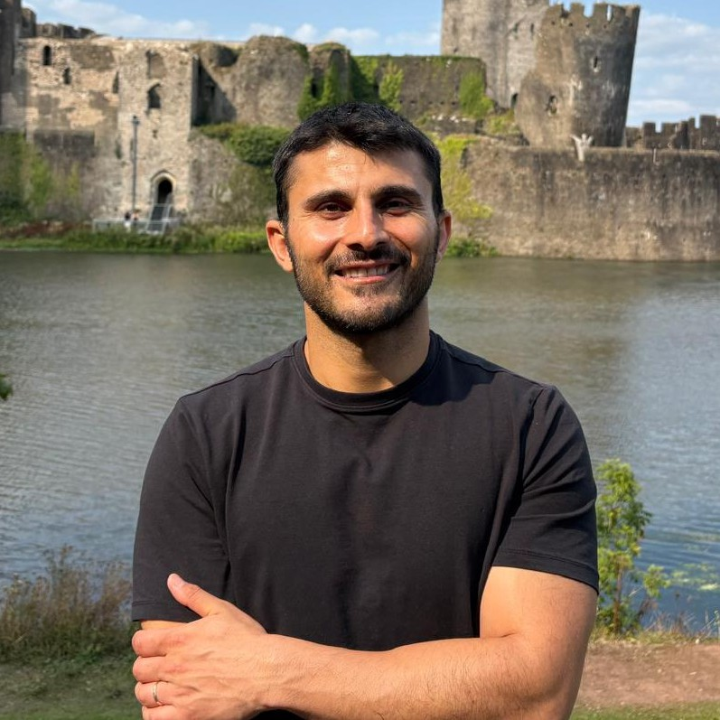
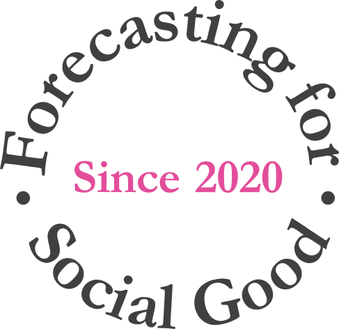
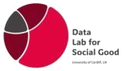
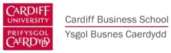
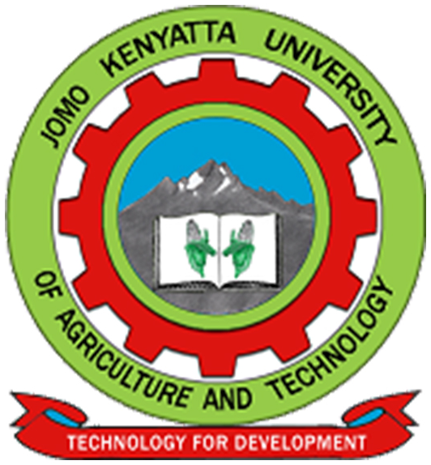
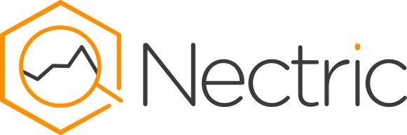

::: {.home-hero .column-screen}
::: {.home-hero-inner}
::: {.home-hero-text}
[AFRICAST 2026 · Forecasting for Social Good]{.kicker}

# Tidy time series & forecasting in R {.unnumbered .unlisted}

19–23 October 2026 · Online training course
:::

::: {.home-hero-actions}
[Get set up](#before-you-start){.btn .btn-hero}
[Download slides](slides.zip){.btn .btn-hero-outline}
:::
:::
:::

::: {.home-about .column-page}
::: {.home-about-video}
<iframe src="https://www.youtube.com/embed/4pYlobR-rbQ?si=p795vCfEx38K98KU" title="About the AFRICAST project" frameborder="0" allow="accelerometer; autoplay; clipboard-write; encrypted-media; gyroscope; picture-in-picture; web-share" allowfullscreen></iframe>
:::

::: {.home-about-text}
## About AFRICAST {.unnumbered}

AFRICAST is part of the [Forecasting for Social Good (F4SG)](https://www.f4sg.org/) initiative, building forecasting skills among researchers in Low- and Middle-Income Countries so that forecasts can inform planning and resource allocation. No prior experience with time series is needed.

During the training, you'll learn to:

1. Prepare time series data for analysis and exploration.
2. Extract and compute useful features from time series data and visualise them effectively.
3. Identify appropriate forecasting algorithms and select the best approach for the data at hand.

[Read more about the workshop](about.qmd)
:::
:::

::: {.column-page}
# Sessions

Each day has two 90-minute live sessions, then exercises with mentors in the afternoon.

::: {#sessions}
:::
:::

::: {.column-page}
# Educators

::: {.educators}
::: {.educator}
{fig-alt="Headshot of Mitchell O'Hara-Wild"}

[Mitchell O'Hara-Wild](about.qmd#mitchell)

Monash University

Lead developer of fable
:::

::: {.educator}
{fig-alt="Headshot of Bahman Rostami-Tabar"}

[Bahman Rostami-Tabar](about.qmd#bahman)

Cardiff University

Founder of F4SG
:::

::: {.educator}
{fig-alt="Headshot of Abiodun Egwuenu"}

[Abiodun Egwuenu](about.qmd#abiodun)

Charité Berlin

Field epidemiologist
:::

::: {.educator}
{fig-alt="Headshot of Harsha Halgamuwe Hewage"}

[Harsha Halgamuwe Hewage](about.qmd#harsha)

Cardiff University

Supply chain forecaster
:::

::: {.educator}
{fig-alt="Headshot of Mustafa Aslan"}

[Mustafa Aslan](about.qmd#mustafa)

Cardiff University

Healthcare forecaster
:::
:::

[Read full bios, the planning team and mentors →](about.qmd#educators)
:::

::: {.column-page}
# Before you start

You should be comfortable writing R code with tidyverse packages such as dplyr and ggplot2 (if not, work through <https://startr.numbat.space/> first). Some familiarity with the mean, variance, quantiles, the normal distribution and regression will help, but isn't required. Please have everything below ready on your own laptop before the workshop.

::: {.setup-steps}
::: {.setup-step}
### Install R and an IDE

A recent version of R (4.1+) and an IDE such as RStudio or Positron.
:::

::: {.setup-step}
### Install the packages

```r
install.packages(c("tidyverse", "fpp3", "GGally", "ggtime", "astsa", "usethis"))
```
:::

::: {.setup-step}
### Download the exercises

```r
usethis::use_course("https://workshop.f4sg.org/africast/exercises.zip")
```
:::
:::
:::

::: {.column-page}
# Supported by

::: {.orgs}
[](https://forecasters.org/)
[](https://www.f4sg.org/)
[](https://www.cardiff.ac.uk/research/explore/research-units/data-lab-for-social-good)
[](https://www.cardiff.ac.uk/business-school)
[](https://www.monash.edu/business)
[](https://www.jkuat.ac.ke/)
[](https://nectric.com.au/)
:::
:::
