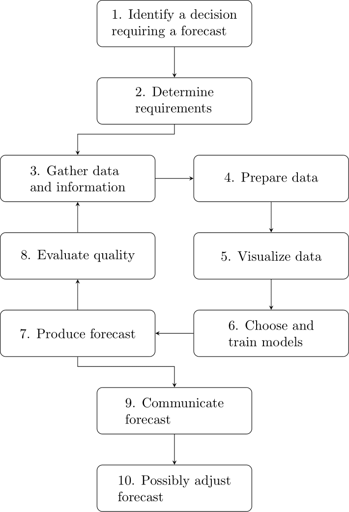

## Outline

* Introduction to forecasting
* Time series data
* tsibble objects
* Example: Australian prison population
* Example: Australian pharmaceutical sales

```{r}
#| label: setup
#| include: false
#| cache: false
source("setup.R")
ausbeer <- aus_production |>
  select(Time = Quarter, Production = Beer)
library(fpp3)
library(tidyverse)
```

# Introduction to forecasting

## What is a forecast?

Estimating how a sequence of observations will continue into the future, using all information available now.

```{r forecasting,echo=FALSE, out.width="90%", fig.align='center'}
ausbeer |> model(ETS(Production)) |> forecast(h=20) |> autoplot(tail(ausbeer, 60), level=NULL, alpha=.01)+
  geom_vline(xintercept = as.numeric(as.Date("2010-04-01")),col="red", linetype = "longdash")+
  labs(x ="Time",y="Observation",title = "Forecasting")
```

## What data do we need?

1. Historical data on the variable to forecast
2. Past and future values of predictors
    + Deterministic (e.g. holidays)
    + Stochastic (e.g. temperature)
3. Expert knowledge and context
    + New information

## Why forecast?

Why do you use forecasts?

::: {.fragment}
| Decision                                              | Forecast  |
| ----------------------------------------------------- |:---------:|
| Build a new hospital in the next 10 years?            |      ?    |
| Call centre staff needed next week?                   |      ?    |
| Vaccine doses needed next month?                      |      ?    |

* Supports planning
* Informs decisions
* Provides evidence
:::

## Forecasting workflow

```{r forecastingworkflow,echo=FALSE, fig.align='center', out.width="32%"}

```

## Packages for this course

::: {.alertblock .absolute top="-10px" right="0px"}
**[tidyverts.org](https://tidyverts.org)**
:::

::: {.hexes}


:::

## Packages for this course

```r
# Data, graphics and forecasting
library(fpp3)
```

```{r fpp3-attach, echo=FALSE, message=TRUE, comment=""}
local({
  op <- options(cli.width = 66, cli.unicode = FALSE)
  on.exit(options(op))
  ns <- asNamespace("fpp3")
  attach_msg <- ns$fpp3_attach
  environment(attach_msg) <- list2env(
    list(core_unloaded = function() ns$core), parent = ns
  )
  attach_msg()
})
```

# Time series data

## Time series data

* Four-yearly Olympic winning times
* Annual Google profits
* Quarterly Australian beer production
* Monthly rainfall
* Weekly retail sales
* Daily IBM stock prices
* Hourly electricity demand
* 5-minute freeway traffic counts
* Time-stamped stock transaction data

## Your time series

::: {.wordcloud #your-time-series max-words=3 max-answers=3}
What time series data do you work with?
:::

## What makes it a time series?

::: {.block}
Observations + [when]{.alert} they happened.
:::

* The time column is the [index]{.alert}
* Observations are ordered in time
* The frequency matters

# tsibble objects

## A `tsibble` has three parts

::: {.block}
A [tsibble]{.alert} stores one or more time series in a table.
:::

* **Index**: when
* **Key**: which series (optional)
* **Measures**: what was observed

Works with tidyverse functions.

## `tsibble` objects

```{r, echo = TRUE}
global_economy
```

::: {.fragment .ts-part .ts-index .absolute top="180px" left="44px" width="83px" height="388px"}
Index
:::

::: {.fragment .ts-part .ts-key .absolute top="180px" left="132px" width="172px" height="388px"}
Key
:::

::: {.fragment .ts-part .ts-measure .absolute top="180px" left="308px" width="568px" height="388px"}
Measures
:::

## `tsibble` objects

```{r, echo = TRUE}
tourism
```

::: {.fragment .ts-part .ts-index .absolute top="180px" left="44px" width="113px" height="388px"}
Index
:::

::: {.fragment .ts-part .ts-key .absolute top="180px" left="162px" width="348px" height="388px"}
Keys
:::

::: {.fragment .ts-part .ts-measure .absolute top="180px" left="514px" width="83px" height="388px"}
Measure
:::

::: {.block .absolute top="205px" left="625px" width="300px"}
Domestic overnight trips (thousands).
:::

## The `tsibble` index

For annual data, integer years work as the index:

```{r tstable}
annual_data <- tsibble(
  year = 2012:2016,
  y = c(123, 39, 78, 52, 110),
  index = year
)
annual_data
```

## The `tsibble` index

```{r tstablemonth, echo=FALSE}
monthly_data <- tibble(Month = paste(2019, month.abb[1:5]), Observation = c(50, 23, 34, 30, 25))
```

```{r tstablemonth2}
monthly_data
```

::: {.fragment}
* `"2019 Jan"` is just text
* More frequent than yearly? Use a time class
:::

## The `tsibble` index

```{r month-tsibble}
monthly_data |>
  mutate(Month = yearmonth(Month)) |>
  as_tsibble(index = Month)
```

## The `tsibble` index

Common time index variables can be created with these functions:

```{r tstable2, echo=FALSE}
tribble(
  ~`Frequency`, ~Function,
  "Annual", "`start:end`",
  "Quarterly", "`yearquarter()`",
  "Monthly", "`yearmonth()`",
  "Weekly", "`yearweek()`",
  "Daily", "`as_date()`, `ymd()`",
  "Sub-daily", "`as_datetime()`, `ymd_hms()`"
) |>
  knitr::kable()
```

## Converting dates

Often data is provided as dates, even if it isn't daily.

```{r convert-dates, collapse=TRUE}
my_date <- as.Date("2026-10-01")
yearquarter(my_date)
yearmonth(my_date)
yearweek(my_date)
```

## Looking ahead: `mixtime` {.code-small}

{.absolute bottom="0px" right="0px" height="180px"}

One family of linear time classes, including `year()` and `datetime()`:

```{r mixtime-linear, cache=FALSE, collapse=TRUE}
library(mixtime)
c(year(my_date), yearquarter(my_date), yearmonth(my_date), date(my_date))
```

::: {.fragment}
Any granularity from a [chronon]{.alert} (one time step) and `linear_time()`:

```{r mixtime-chronon, cache=FALSE, collapse=TRUE}
quarter_hours <- datetime("2024-01-01 00:00:00") + minutes(0:3) * 15L
linear_time(quarter_hours, chronon = cal_gregorian$minute(15L))
```

* `yearmonth(my_date)` is `linear_time(my_date, chronon = cal_gregorian$month(1L))`
:::

## Looking ahead: `mixtime` {.code-small}

{.absolute bottom="0px" right="0px" height="180px"}

More time types, beyond this course:

```{r mixtime-more, cache=FALSE, collapse=TRUE}
# Timezones
datetime(as.POSIXct("2026-10-05 22:30", tz = "UTC"), tz = "Africa/Nairobi")
# Other calendars (also cal_isoweek, lunar and solar calendars)
linear_time(my_date, chronon = cal_sym454$month(1L))
# Cyclical time
day_of_week(my_date)
# Durations
yearmonth(my_date) + months(0:2)
```

```{r mixtime-detach, include=FALSE, cache=FALSE}
# The rest of the course uses the tsibble time classes
detach("package:mixtime")
```

# Example: Australian prison population

## Australian prison population

{.photo}

## Read a csv file

```{r prison}
prison <- readr::read_csv("data/prison_population.csv")
```
```{r prison2a, dependson="prison", echo=FALSE}
prison
```

## Convert to a time class

```{r prison3}
prison <- readr::read_csv("data/prison_population.csv") |>
  mutate(quarter = yearquarter(date))
```

```{r prison3a, dependson="prison3", echo=FALSE}
prison
```

## Remove the old date column

```{r prison4}
prison <- readr::read_csv("data/prison_population.csv") |>
  mutate(quarter = yearquarter(date)) |>
  select(-date)
```

```{r prison4a, dependson="prison4", echo=FALSE}
prison
```

## Declare the index and keys {.code-small}

```{r prison5}
prison <- readr::read_csv("data/prison_population.csv") |>
  mutate(quarter = yearquarter(date)) |>
  select(-date) |>
  as_tsibble(
    index = quarter,
    key = c(state, gender, legal, indigenous)
  )
```

```{r prison5a, dependson="prison5", echo=FALSE}
prison
```

# Example: Australian pharmaceutical sales

## Australian Pharmaceutical Benefits Scheme

{.photo}

## Australian Pharmaceutical Benefits Scheme

::: {.block}
The [PBS]{.alert} is the Australian government drug subsidy scheme.
:::

::: {.fragment}
* Subsidises many pharmacy drugs
* Costs nearly 1% of GDP
* Budget relies on forecasts of drug usage
* Split by drug type (ATC2 x`r length(unique(PBS$ATC2))`), concession (x`r length(unique(PBS$Concession))`) and patient type (x`r length(unique(PBS$Type))`)
:::

## Working with `tsibble` objects

```{r wide, include=FALSE}
options(width = 78)
```

```{r pbs1, dependson='wide'}
PBS
```

## `filter()`: choose rows

```{r pbs2}
PBS |>
  filter(ATC2 == "A10")
```

## `select()`: choose columns {.code-small}

```{r pbs3}
PBS |>
  filter(ATC2 == "A10") |>
  select(Month, Concession, Type, Cost)
```

## `summarise()`: combine over keys {.code-small}

```{r pbs4}
PBS |>
  filter(ATC2 == "A10") |>
  select(Month, Concession, Type, Cost) |>
  summarise(total_cost = sum(Cost))
```

## `mutate()`: create variables {.code-small}

```{r pbs5}
PBS |>
  filter(ATC2 == "A10") |>
  select(Month, Concession, Type, Cost) |>
  summarise(total_cost = sum(Cost)) |>
  mutate(total_cost = total_cost / 1e6)
```

## Save the result {.code-small}

```{r pbs6}
PBS |>
  filter(ATC2 == "A10") |>
  select(Month, Concession, Type, Cost) |>
  summarise(total_cost = sum(Cost)) |>
  mutate(total_cost = total_cost / 1e6) -> a10
```

```{r a10, echo=FALSE, dependson="pbs6"}
a10
```

```{r narrow, include=FALSE}
options(width = 60)
```

## Your turn

::: {.callout-note}
## Using `tourism`

1. Find the quarterly total `Trips` for each `State`
2. **Challenge:** Which `State` had the most `Trips` over the whole period?
:::

::: {.callout-note}
## Using `PBS`

3. Find the total monthly `Scripts` for ATC2 `"H02"`
:::

::: {.fragment}
::: {.callout-important}
## Hints

* `summarise()` always keeps the index
* `group_by()` the keys you want to keep
* `as_tibble()` drops the index, to summarise over time
:::
:::

## Recap

* A tsibble has an **index**, **keys** and **measures**
* The index needs a time class (`yearmonth()`, `as_date()`, ...)
* Use dplyr verbs to wrangle tsibbles
