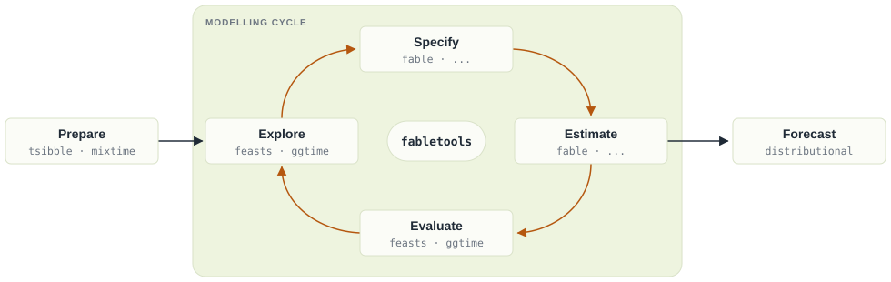
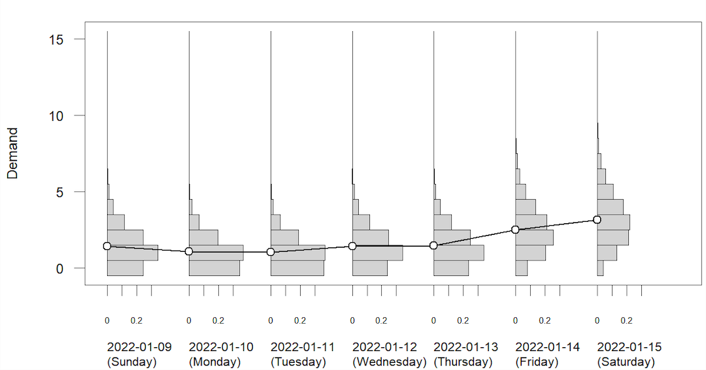
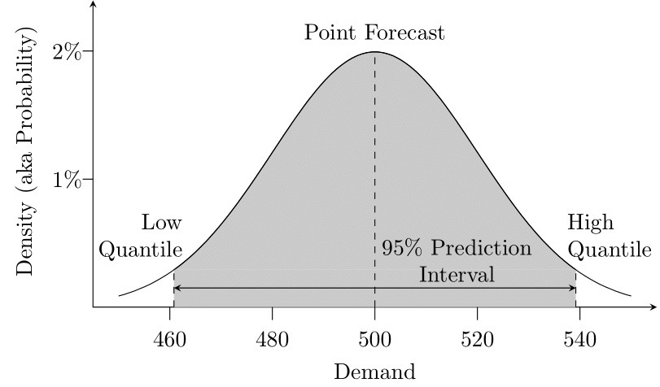
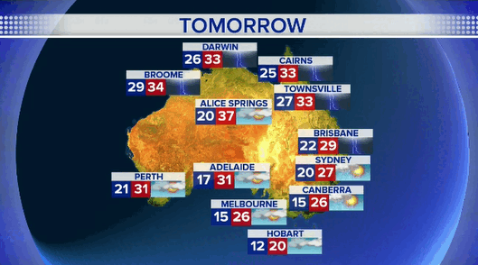

## Outline

* Statistical forecasting
* What can we forecast?
* Benchmark methods
* Specify and estimate
* Produce forecasts
* Fitted values and residuals

## Your forecasting

::: {.wordcloud #what-you-forecast max-words=3 max-answers=3}
What do you forecast (or wish you could) in your work?
:::

```{r}
#| label: setup
#| include: false
#| cache: false
source("setup.R")
set.seed(2026)
h02 <- tsibbledata::PBS |>
  filter(ATC2 == "H02") |>
  summarise(Cost = sum(Cost))
melsyd <- tsibbledata::ansett |>
  filter(Airports == "MEL-SYD")

austa <- readxl::read_excel("data/340101.xlsx", sheet = "Data1", skip = 9) |>
  rename(date = `Series ID`, value = A85375847A) |>
  select(date, value) |>
  transmute(
    Month = yearmonth(date),
    Visitors = value / 1e3
  ) |>
  bind_rows(tibble(
    Month = yearmonth(seq(as.Date("2021-11-01"), by = "1 month", length = 2)),
    Visitors = NA_real_
  )) |>
  as_tsibble(index = Month) |>
  filter(Month >= yearmonth("2000 Jan"))
```

# Statistical forecasting

## Forecasting workflow

```{r forecasting_process,echo=FALSE, fig.align='center'}
knitr::include_graphics("figs/forecasting_workflow.png")
```

## Statistical forecasting steps

{fig-align="center" width="100%"}

## What is a forecast?

```{r austa, echo=FALSE}
austa <- readxl::read_excel("data/340101.xlsx", sheet = "Data1", skip = 9) |>
  rename(date = `Series ID`, value = A85375847A) |>
  select(date, value) |>
  transmute(
    Month = yearmonth(date),
    Visitors = value / 1e3
  ) |>
  bind_rows(tibble(
    Month = yearmonth(seq(as.Date("2021-11-01"), by = "1 month", length = 2)),
    Visitors = NA_real_
  )) |>
  as_tsibble(index = Month) |>
  filter(Month >= yearmonth("2000 Jan"))
# Grab ABS data
# Fit ETS model
fit <- austa |>
  filter(Month < yearmonth("2018 Jan")) |>
  model(ETS(Visitors))
# Product forecasts
fc <- forecast(fit, h = 48) |>
  mutate(Month = as.Date(Month))
# Simulate 100 future sample paths
set.seed(1967)
sim <- fit |>
  generate(h = 48, times = 100) |>
  mutate(
    replicate = factor(.rep, levels = 1:100, labels = paste("Future", 1:100)),
    .rep = as.numeric(.rep)
  ) |>
  as_tibble() |>
  mutate(Month = as.Date(Month))
# Nice colours
cols <- scale_colour_manual(
  values = c("#D55E00", "#0072B2", "#009E73", "#CC79A7", "#E69F00", "#56B4E9", "#F0E442", sample(rainbow(93))),
  breaks = paste("Future", 1:100),
  name = " "
)
# Now build up some plots with alignment
p1 <- austa |>
  mutate(Visitors = if_else(Month >= yearmonth("2018 Jan"), NA_real_, Visitors)) |>
  as_tibble() |>
  mutate(Month = as.Date(Month)) |>
  ggplot(aes(x = Month, y = Visitors)) +
  geom_line() +
  labs(
    x = "Month",
    y = "Thousands of visitors",
    title = "Total short-term visitors to Australia"
  ) +
  scale_x_date(
    breaks = seq(as.Date("2000-01-01"), by = "5 years", l = 5),
    labels = paste("Jan", seq(2000, 2020, by = 5)),
    minor_breaks = seq(as.Date("2001-01-01"), by = "1 year", l = 25)
  ) +
  ylim(min(austa$Visitors, sim$.sim, na.rm = TRUE), max(austa$Visitors, sim$.sim, na.rm = TRUE))
p2 <- p1 + cols +
  geom_line(aes(y = .sim, group = replicate, colour = replicate),
    data = sim |> filter(.rep <= 1)
  )
p3 <- p1 + cols +
  geom_line(aes(y = .sim, group = replicate, colour = replicate),
    data = sim |> filter(.rep <= 2)
  )
p4 <- p1 + cols +
  geom_line(aes(y = .sim, group = replicate, colour = replicate),
    data = sim |> filter(.rep <= 3)
  )
p5 <- p1 + cols +
  geom_line(aes(y = .sim, group = replicate, colour = replicate),
    data = sim |> filter(.rep <= 10)
  )
p6 <- p1 + cols +
  geom_line(aes(y = .sim, group = replicate, colour = replicate), alpha = 0.5, data = sim) +
  guides(colour = "none")
p7 <- p1 +
  geom_line(aes(y = .sim, group = replicate, colour = replicate), alpha = 0.5, col = "gray", data = sim) +
  guides(colour = "none")
p8 <- p7 + autolayer(fc, level = c(50, 90))
p9 <- p8 + coord_cartesian(xlim = as.Date(c("2014-01-01", "2021-08-01"))) +
  scale_x_date(
    breaks = seq(as.Date("2000-01-01"), by = "2 years", l = 11),
    labels = paste("Jan", seq(2000, 2020, by = 2)),
    minor_breaks = seq(as.Date("2001-01-01"), by = "1 year", l = 25)
  )
aligned_plots <- align_patches(p1, p2, p3, p4, p5, p6, p7, p8, p9)
```

::: {.alertblock style="font-size:0.7em"}
A forecast is an estimate of the probability distribution of a variable to be observed in the future.
:::

::: {.fragment}
```{r austa1, dependson="austa", echo=FALSE}
aligned_plots[[1]]
```
:::

## What is a forecast?

::: {.alertblock style="font-size:0.7em"}
A forecast is an estimate of the probability distribution of a variable to be observed in the future.
:::

```{r austa9b, dependson='austa', echo=FALSE}
aligned_plots[[9]] +
  geom_line(
    colour = "black",
    data = austa |> filter(Month >= yearmonth("2018 Jan")) |> mutate(Month = as.Date(Month))
  )
```

::: {.block .absolute top="640px" right="0px" width="260px" style="font-size:0.6em;"}
Simulated futures from an ETS model
:::

## Was this a good forecast?

::: {.poll #good-forecast}
- Yes
- No
:::

## What is a forecast?

::: {.alertblock style="font-size:0.7em"}
A forecast is an estimate of the probability distribution of a variable to be observed in the future.
:::

```{r austa2, dependson='austa', echo=FALSE}
aligned_plots[[2]]
```

::: {.block .absolute top="640px" right="0px" width="260px" style="font-size:0.6em;"}
Simulated futures from an ETS model
:::

## What is a forecast?

::: {.alertblock style="font-size:0.7em"}
A forecast is an estimate of the probability distribution of a variable to be observed in the future.
:::

```{r austa3, dependson='austa', echo=FALSE}
aligned_plots[[3]]
```

::: {.block .absolute top="640px" right="0px" width="260px" style="font-size:0.6em;"}
Simulated futures from an ETS model
:::

## What is a forecast?

::: {.alertblock style="font-size:0.7em"}
A forecast is an estimate of the probability distribution of a variable to be observed in the future.
:::

```{r austa4, dependson='austa', echo=FALSE}
aligned_plots[[4]]
```

::: {.block .absolute top="640px" right="0px" width="260px" style="font-size:0.6em;"}
Simulated futures from an ETS model
:::

## What is a forecast?

::: {.alertblock style="font-size:0.7em"}
A forecast is an estimate of the probability distribution of a variable to be observed in the future.
:::

```{r austa5, dependson='austa', echo=FALSE}
aligned_plots[[5]]
```

::: {.block .absolute top="640px" right="0px" width="260px" style="font-size:0.6em;"}
Simulated futures from an ETS model
:::

## What is a forecast?

::: {.alertblock style="font-size:0.7em"}
A forecast is an estimate of the probability distribution of a variable to be observed in the future.
:::

```{r austa6, dependson='austa', echo=FALSE}
aligned_plots[[6]]
```

::: {.block .absolute top="640px" right="0px" width="260px" style="font-size:0.6em;"}
Simulated futures from an ETS model
:::

## What is a forecast?

::: {.alertblock style="font-size:0.7em"}
A forecast is an estimate of the probability distribution of a variable to be observed in the future.
:::

```{r austa7, dependson='austa', echo=FALSE}
aligned_plots[[7]]
```

::: {.block .absolute top="640px" right="0px" width="260px" style="font-size:0.6em;"}
Simulated futures from an ETS model
:::

## What is a forecast?

::: {.alertblock style="font-size:0.7em"}
A forecast is an estimate of the probability distribution of a variable to be observed in the future.
:::

```{r austa8, dependson='austa', echo=FALSE}
aligned_plots[[8]]
```

::: {.block .absolute top="640px" right="0px" width="260px" style="font-size:0.6em;"}
Simulated futures from an ETS model
:::

## Prediction interval

::: {.alertblock style="font-size:0.7em"}
A forecast is an estimate of the probability distribution of a variable to be observed in the future.
:::

```{r austa9, dependson='austa', echo=FALSE}
aligned_plots[[9]]
```

::: {.block .absolute top="640px" right="0px" width="260px" style="font-size:0.6em;"}
Simulated futures from an ETS model
:::

## Visualising forecast distributions

```{r viz-prob-forecast,echo=FALSE, out.width="70%", fig.align='center'}

```

## Forecast distribution

```{r fcst-viz-dist,echo=FALSE, out.width="70%", fig.align='center'}

```

## Statistical forecasting

- Thing to be forecast: $y_{T+h}$.
- What we know: $y_1,\dots,y_T$.
- Forecast distribution: $y_{T+h|T} = y_{T+h} \mid \{y_1,y_2,\dots,y_{T}\}$.
- Point forecast: $\hat{y}_{T+h|T} =\text{E}[y_{T+h} \mid y_1,\dots,y_T]$.
- Forecast variance: $\text{Var}[y_{T+h} \mid y_1,\dots,y_T]$.
- Prediction interval is a range of values of $y_{T+h}$ with high probability.


# What can we forecast?

## What can we forecast?

{.photo}

## What can we forecast?

{.photo}

## What can we forecast?

{.photo}

## What can we forecast?

{.photo}

## What can we forecast?

{.photo}

## What can we forecast?

{.photo}

## What can we forecast?

{.photo}

## Which is easiest to forecast?

::: {.poll #easiest-to-forecast}
- daily electricity demand in 3 days time
- timing of next Halley's comet appearance
- time of sunrise this day next year
- Google stock price tomorrow
- Google stock price in 6 months time
- maximum temperature tomorrow
- exchange rate of \$US/AUS next week
- total sales of drugs in Australian pharmacies next month
:::

## Which is hardest to forecast?

::: {.poll #hardest-to-forecast}
- daily electricity demand in 3 days time
- timing of next Halley's comet appearance
- time of sunrise this day next year
- Google stock price tomorrow
- Google stock price in 6 months time
- maximum temperature tomorrow
- exchange rate of \$US/AUS next week
- total sales of drugs in Australian pharmacies next month
:::

## Factors affecting forecastability

Something is easier to forecast if:

 - we have a good understanding of the factors that contribute to it
 - there is lots of data available;
 - the forecasts cannot affect the thing we are trying to forecast.
 - there is relatively low natural/unexplainable random variation.
 - the future is somewhat similar to the past


# Benchmark methods

## Some simple forecasting methods

```{r ausbeer, out.width="90%", echo=FALSE}
new_production <- aus_production |>
  filter(year(Quarter) >= 1992)
new_production |> autoplot(Beer) +
  labs(
    x = "Year", y = "megalitres",
    title = "Australian quarterly beer production"
  )
```

::: {.alertblock .absolute bottom="20px" left="30px" width="560px"}
How would you forecast these series?
:::

## Some simple forecasting methods

```{r pigs, out.width="90%", echo=FALSE}
aus_livestock |>
  filter(
    between(year(Month), 1992, 1996),
    Animal == "Pigs", State == "Victoria"
  ) |>
  autoplot(Count) +
  labs(
    x = "Year", y = "Number of pigs",
    title = "Number of pigs slaughtered in Victoria, 1992-1996"
  )
```

::: {.alertblock .absolute bottom="20px" left="30px" width="560px"}
How would you forecast these series?
:::

## Some simple forecasting methods

```{r dj, out.width="90%", echo=FALSE}
gafa_stock |>
  filter(Symbol == "FB", Date >= ymd("2018-01-01")) |>
  autoplot(Close) +
  labs(
    title = "Facebook closing stock price in 2018",
    x = "Date", y = "Closing price ($USD)"
  )
```

::: {.alertblock .absolute bottom="20px" left="30px" width="560px"}
How would you forecast these series?
:::

## Some simple forecasting methods

### `MEAN(y)`: Average method

  * Forecast of all future values is equal to mean of historical data $\{y_1,\dots,y_T\}$.
  * Forecasts: $\hat{y}_{T+h|T} = \bar{y} = (y_1+\dots+y_T)/T$

```{r mean-method-explained, echo=FALSE, message=FALSE, warning=FALSE, fig.height = 3.4}
bricks <- aus_production |>
  filter(!is.na(Bricks)) |>
  mutate(average = mean(Bricks))

fc <- bricks |>
  model(MEAN(Bricks)) |>
  forecast(h = "5 years")

bricks |>
  ggplot(aes(x = Quarter, y = Bricks)) +
  geom_line() +
  geom_line(aes(y = average), colour = "blue", linetype = "dashed") +
  geom_line(aes(y = .mean), data = fc, colour = "blue") +
  labs(title = "Clay brick production in Australia")
```

## Some simple forecasting methods

### `NAIVE(y)`: Naïve method

  * Forecasts equal to last observed value.
  * Forecasts: $\hat{y}_{T+h|T} =y_T$.
  * Optimal when the series is a random walk (e.g. stock prices).

```{r naive-method-explained, echo = FALSE, warning = FALSE, fig.height = 3.4}
bricks |>
  filter(!is.na(Bricks)) |>
  model(NAIVE(Bricks)) |>
  forecast(h = "5 years") |>
  autoplot(filter(bricks, year(Quarter) > 1990), level = NULL) +
  geom_point(aes(y = Bricks), data = slice(bricks, n()), colour = "blue") +
  labs(title = "Clay brick production in Australia")
```

## Some simple forecasting methods

### `SNAIVE(y ~ lag(m))`: Seasonal naïve method

  * Forecasts equal to last value from same season.
  * Forecasts: $\hat{y}_{T+h|T} =y_{T+h-m(k+1)}$, where $m=$ seasonal period and $k$ is the integer part of $(h-1)/m$.
  * `lag()` defaults to the seasonal period, so `SNAIVE(y)` is enough.

```{r snaive-method-explained, echo = FALSE, warning = FALSE, fig.height = 3.4}
bricks |>
  model(SNAIVE(Bricks ~ lag("year"))) |>
  forecast(h = "5 years") |>
  autoplot(filter(bricks, year(Quarter) > 1990), level = NULL) +
  geom_point(aes(y = Bricks), data = slice(bricks, (n() - 3):n()), colour = "blue") +
  labs(title = "Clay brick production in Australia")
```

## Some simple forecasting methods

### `RW(y ~ drift())`: Drift method

 * Forecasts equal to last value plus average change.
 * Forecasts:

$$\begin{aligned}
\hat{y}_{T+h|T} & =  y_{T} + \frac{h}{T-1}\sum_{t=2}^T (y_t-y_{t-1})\\
                & = y_T + \frac{h}{T-1}(y_T -y_1).
\end{aligned}$$

   * Equivalent to extrapolating a line drawn between first and last observations.

## Some simple forecasting methods

### Drift method

```{r drift-method-explained, echo = FALSE, warning = FALSE}
aus_production |>
  filter(!is.na(Bricks)) |>
  model(RW(Bricks ~ drift())) |>
  forecast(h = "5 years") |>
  autoplot(aus_production, level = NULL) +
  geom_line(
    aes(y = Bricks),
    data = slice(aus_production, range(cumsum(!is.na(Bricks)))),
    linetype = "dashed", colour = "blue"
  ) +
  labs(title = "Clay brick production in Australia")
```

## Which benchmark suits the pigs series?

::: {.poll #pigs-benchmark}
Which benchmark method is best for the number of pigs slaughtered in Victoria?

- `MEAN()`
- `NAIVE()`
- `SNAIVE()`
- `RW(~ drift())`
:::

# Specify and estimate

## Model specification

- Model specification in fable supports a formula-based interface.
- A model formula in R is expressed using `response ~ terms`:
    - the left side describes the response;
    - the right side describes the terms used to model the response.
- Model names are in capitals, e.g. `SNAIVE(Beer ~ lag("year"))` or `RW(Beer ~ drift())`.

## Model fitting: example {.code-small}

The `model()` function trains models on data.


```{r beer-model}
beer_fit <- aus_production |>
  model(
    Seasonal_naive = SNAIVE(Beer),
    Naive = NAIVE(Beer),
    Drift = RW(Beer ~ drift()),
    Mean = MEAN(Beer)
  )
```

```{r beer-model2, echo=FALSE, dependson='beer-model'}
beer_fit
```

::: {.alertblock}
A `mable` is a model table, each cell corresponds to a fitted model.
:::

## Extract information from `mable`

```{r beer-mablea, eval= FALSE, dependson='beer-model'}
beer_fit |> select(Seasonal_naive) |> report()
beer_fit |> tidy()
beer_fit |> glance()
```

- `report()` gives a formatted model-specific display.
- `tidy()` extracts the estimated parameters (if any) of each model.
- `glance()` gives one row of summary statistics per model, such as `sigma2`.
- `select()` and `filter()` pick out specific models.

# Produce forecasts

## Producing forecasts

- The `forecast()` function is used to produce forecasts from estimated models.
- The forecast horizon can be specified with:
    * `h` as a number (the number of future observations);
    * `h` as natural language (the length of time to predict, e.g. `"5 years"`);
    * `new_data`, a dataset of future time periods.
    
## Producing forecasts


```{r beer-fc, echo = TRUE, dependson='beer-model'}
beer_fc <- beer_fit |>
  forecast(h = "5 years")
```

```{r beer-fbl, echo = FALSE, dependson='beer-fc'}
print(beer_fc, n = 4)
```

::: {.alertblock}
A `fable` is a forecast table with point forecasts and distributions.
:::

## Visualising forecasts

```{r beer-fc-plot, warning=FALSE, message=FALSE, fig.height=3.4, dependson='beer-fc'}
beer_fc |>
  autoplot(filter(aus_production, year(Quarter) >= 1995), level = NULL) +
  labs(title = "Forecasts for quarterly beer production",
       x = "Quarter", y = "Megalitres") +
  guides(colour = guide_legend(title = "Forecast"))
```


## Forecast distributions

 * A forecast $\hat{y}_{T+h|T}$ is (usually) the mean of the conditional distribution $y_{T+h} \mid y_1, \dots, y_{T}$.
 * Most time series models produce normally distributed forecasts.
 * The forecast distribution describes the probability of observing any future value.

## Forecast distributions - normal distribution

Assuming residuals are normal, uncorrelated, sd = $\hat\sigma$:

::: {.block}
| | |
|:--|:--|
| **Mean:** | $y_{T+h|T} \sim N(\bar{y}, (1 + 1/T)\hat{\sigma}^2)$ |
| **Naïve:** | $y_{T+h|T} \sim N(y_T, h\hat{\sigma}^2)$ |
| **Seasonal naïve:** | $y_{T+h|T} \sim N(y_{T+h-m(k+1)}, (k+1)\hat{\sigma}^2)$ |
| **Drift:** | $y_{T+h|T} \sim N(y_T + \frac{h}{T-1}(y_T - y_1),h\frac{T+h}{T}\hat{\sigma}^2)$ |
:::

where $k$ is the integer part of $(h-1)/m$.

Note that when $h=1$ and $T$ is large, these all give the same approximate forecast variance: $\hat{\sigma}^2$.
 
## Forecast distributions from bootstrapping

When a normal distribution for the residuals is an unreasonable assumption, one alternative is to use bootstrapping, which only assumes that the residuals are uncorrelated with constant variance.

- A one-step forecast error is defined as $e_t = y_t - \hat{y}_{t|t-1}$, $y_t = \hat{y}_{t|t-1} + e_t.$

- So we can simulate the next observation of a time series using $y_{T+1} = \hat{y}_{T+1|T} + e_{T+1}$

- Adding the new simulated observation to our data set, we can repeat the process to obtain $y_{T+2} = \hat{y}_{T+2|T+1} + e_{T+2}$

## Generate many possible future using `generate()` {.code-small}

```{r generate, echo=TRUE}
beer_2000 <- aus_production |> filter(year(Quarter) >= 2000) |> select(Beer)
fit <- beer_2000 |>
  model(NAIVE(Beer))
set.seed(2024)
sim <- fit |> generate(h = 12, times = 5, bootstrap = TRUE)
sim
```

## Generate 5 different futures

```{r visualise-future, echo=FALSE}
beer_2000 |> 
  ggplot(aes(x = Quarter)) +
  geom_line(aes(y = Beer)) +
  geom_line(aes(y = .sim, colour = as.factor(.rep)),
    data = sim)+
  labs(colour="Future")
```

## Use `forecast()` function to generate probabilistic forecasts {.code-small}

```{r probabilistic-forecast, echo=TRUE}
fc <- fit |> forecast(h = 12, bootstrap = TRUE)
fc
```


## Prediction intervals {.code-small}

- Forecast intervals can be extracted using the `hilo()` function.

```{r fb-fc, echo=TRUE}
fit <- aus_production |> select(Beer) |> model(NAIVE(Beer))
forecast(fit) |> mutate(`95%` = hilo(Beer, 95))
```

## Prediction intervals {.code-small}

```{r beer-fc-interval, dependson='beer-fc'}
beer_fc |>
  mutate(hilo(Beer, list(`50%` = 50, `75%` = 75)))
```

## Prediction intervals {.code-small}

```{r beer-fc-interval2, dependson='beer-fc'}
beer_fc |>
  mutate(`50%` = hilo(Beer, 50)) |>
  mutate(lower = `50%`$lower, upper = `50%`$upper)
```

# Fitted values and residuals

## Fitted values

 - $\hat{y}_{t|t-1}$ is the forecast of $y_t$ based on observations $y_1,\dots,y_{t-1}$.
 - We call these "fitted values".
 - Sometimes drop the subscript: $\hat{y}_t \equiv \hat{y}_{t|t-1}$.
 - Often not true forecasts since parameters are estimated on all data.

### For example:

 - $\hat{y}_{t} = \bar{y}$ for average method.
 - $\hat{y}_{t} = y_{t-1} + (y_{T}-y_1)/(T-1)$ for drift method.

## Forecasting residuals

::: {.block}
**Residuals in forecasting:** difference between observed value and its fitted value: $e_t = y_t-\hat{y}_{t|t-1}$.
:::


## Beer production - augment {.code-small}

```{r augment}
fit <- aus_production |> select(Beer) |> model(SNAIVE(Beer))
augment(fit)
```

## Beer production - fitted values

```{r dj4, echo=TRUE, warning=FALSE, fig.height=3.4, dependson="augment"}
augment(fit) |>
  ggplot(aes(x = Quarter)) +
  geom_line(aes(y = Beer, colour = "Data")) +
  geom_line(aes(y = .fitted, colour = "Fitted"))
```

## Beer production - residuals

```{r dj5, echo=TRUE, warning = FALSE, dependson="augment"}
augment(fit) |>
  autoplot(.resid) +
  labs(x = "Quarter", y = "", title = "Residuals from snaïve method")
```

## Beer production - residual ACF {.nostretch}

```{r dj6, echo=TRUE, fig.height=2.2, out.width="70%", fig.align="center", dependson="augment"}
augment(fit) |> ACF(.resid) |> autoplot()
```

::: {.likert #beer-resid-noise}
These residuals look like random noise
:::
