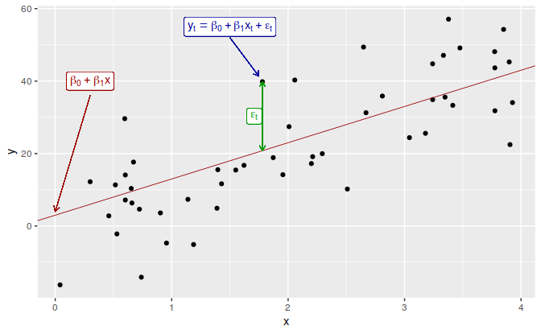
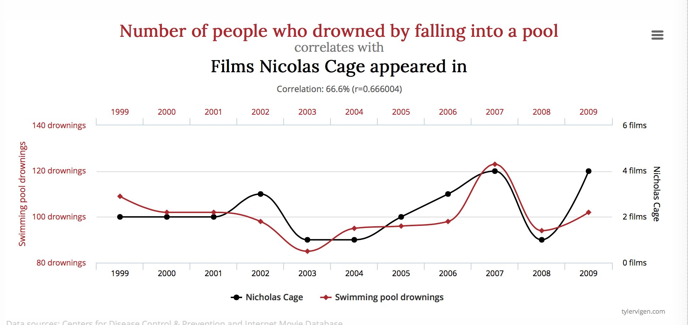
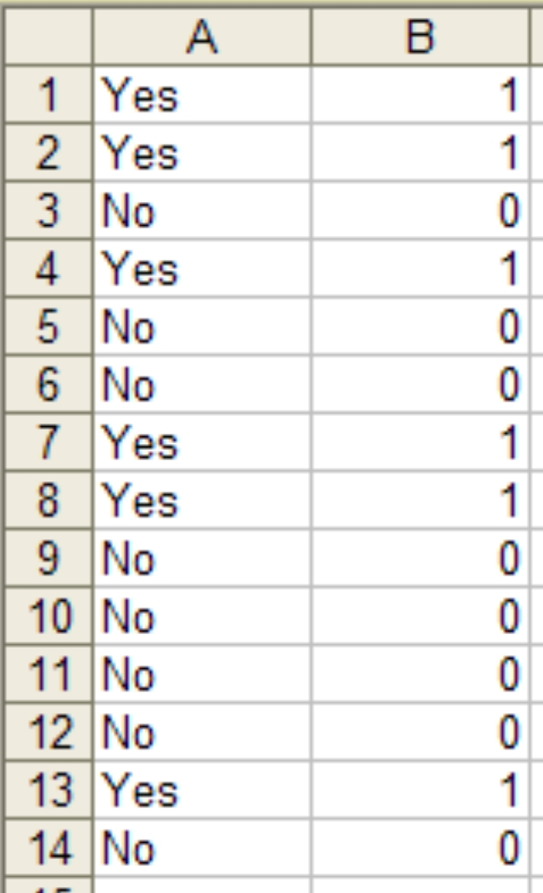
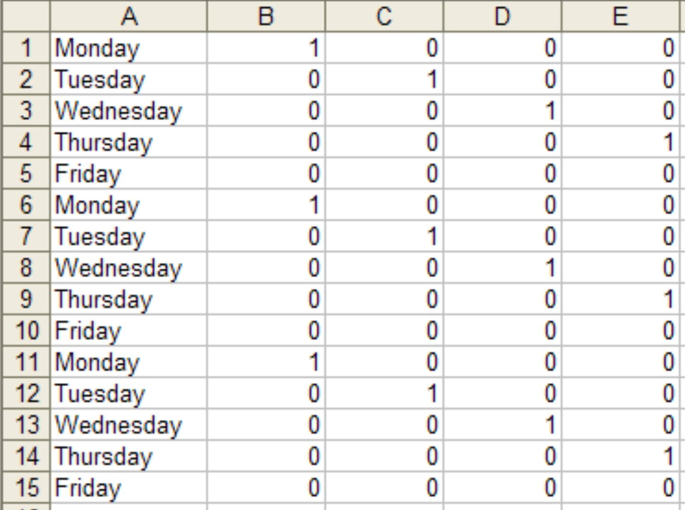

```{r}
#| label: setup
#| include: false
#| cache: false
source("setup.R")
us_change <- readr::read_csv("data/uschange.csv") |>
  mutate(Time = yearquarter(Time)) |>
  as_tsibble(index = Time)
```


# The linear model with time series

## Regression models

* To **explain** 
* To **forecast**

* Simple linear regression model (SLR)
* Multiple linear regression model (MLR)

## SLR model in theory

Regression model allows for a linear relationship between the forecast variable $y$ and a single predictor variable $x$.

::: {.block}
$$
  y_t = \beta_0 + \beta_1 x_{t} + \varepsilon_t.
$$
:::

* $y_t$ is the variable we want to predict: the "response" variable
* Each $x_{t}$ is numerical and is called a "predictor"
* $\beta_0$ and $\beta_1$ are regression coefficients

## SLR model in practice

In practice, of course, we have a collection of observations but we do not know the values of the coefficients $\beta_0$, $\beta_1$.
These need to be estimated from the data.

::: {.block}
$$
  \hat{y}_t = \hat\beta_0 + \hat\beta_1 x_{t}.
$$
:::

* $\hat{y}_t$ is the fitted value of the response
* Each $x_{t}$ is a "predictor"
* $\hat\beta_0$ is the estimated intercept
* $\hat\beta_1$ is the estimated slope

## What is the best fit

* There are many ways that a straight line can be laid on the scatter
* Best known criterion is called Ordinary Least Squares (OLS)

```{r SLR, echo=FALSE, fig.align='center', out.width= "70%"}

```

## Estimation of the model

Least squares chooses the values of $\beta_0$ and $\beta_1$ which minimise

::: {.block}
$$
  \sum_{t=1}^T e_{t}^2 = \sum_{t=1}^T (y_{t} - \beta_{0} - \beta_{1}x_{t})^2.
$$
:::

* This is called *least squares* estimation because it gives the smallest value of the sum of squared errors.
* Finding the best estimates of the coefficients is often called *fitting* the model to the data. 
* We refer to the *estimated* coefficients using the notation $\hat\beta_{0},\hat\beta_{1}$.

## Example: US consumption expenditure

```{r ConsInc, echo=TRUE, fig.height=3.5}
us_change |>
  pivot_longer(c(Consumption, Income), names_to = "Measure", values_to = "Change") |>
  autoplot(Change) +
  labs(x = "Year", y = "% change")
```

## Example: US consumption expenditure

```{r ConsInc2, echo=FALSE}
us_change |>
  ggplot(aes(x=Income, y=Consumption)) +
    labs(x = "Income (quarterly % change)", y = "Consumption (quarterly % change)") +
    geom_point() +
    geom_smooth(method="lm", se=FALSE)
```

## Example: US consumption expenditure {.code-small}

```{r, echo=TRUE}
fit_cons <- us_change |>
  model(lm = TSLM(Consumption ~ Income))
report(fit_cons)
```

## Multiple regression

* In multiple regression there is one variable to be forecast and several predictor variables.
* The basic concept is that we forecast the time series of interest $y$ assuming that it has a linear relationship with other time series $x_1$, $x_2$, ..., $x_k$
* We might forecast daily A&E attendance  $y$ using temperature   $x_1$ and GP visits $x_2$ as predictors.

## How many predictors?

You can add as many as you want but be aware of:

* Over-fitting
* Multicollinearity

## Multiple regression and forecasting

::: {.block}
$$
  y_t = \beta_0 + \beta_1 x_{1,t} + \beta_2 x_{2,t} + \cdots + \beta_kx_{k,t} + \varepsilon_t.
$$

:::

* $y_t$ is the variable we want to predict: the "response" variable
* Each $x_{j,t}$ is numerical and is called a "predictor".
 They are usually assumed to be known for all past and future times.

* The coefficients $\beta_1,\dots,\beta_k$ measure the effect of each predictor after taking account of the effect of all other predictors in the model.
    * That is, the coefficients measure the **marginal effects**.

* $\varepsilon_t$ is a white noise error term

## Estimation of the model

Least squares chooses the values of $\beta_{0},\dots,\beta_{k}$ which minimise

$$
\sum_{t=1}^T e_{t}^2 = \sum_{t=1}^T (y_{t} - \beta_{0} - \beta_{1}x_{1,t} - \cdots - \beta_{k} x_{k,t})^2.
$$

* This is called *least squares* estimation because it gives the smallest value of the sum of squared errors
* Finding the best estimates of the coefficients is often called *fitting* the model to the data
* We refer to the *estimated* coefficients using the notation $\hat\beta_{0},\dots,\hat\beta_{k}$.

## Useful predictors in linear regression

**Linear trend**
$$
  x_t = t
$$

* $t=1,2,\dots,T$
* Strong assumption that trend will continue.
* use special function `trend()`

**Seasonality**

* Seasonality will be considered based on the interval of index
* use special function `season()`

## Example: US consumption expenditure

```{r MultiPredictors, echo=FALSE}
us_change |>
  pivot_longer(-Time, names_to = "Measure", values_to = "Change") |>
  ggplot(aes(x = Time, y = Change, colour = Measure)) +
  geom_line() +
  facet_grid(vars(Measure), scales = "free_y") +
  labs(x = "Year", y = NULL) +
  guides(colour="none")
```

## Example: US consumption expenditure

```{r ScatterMatrix, echo=FALSE}
us_change |>
  as_tibble() |>
  select(-Time) |>
  GGally::ggpairs()
```

## Example: US consumption expenditure {.code-tiny}

```{r usestim, echo=TRUE}
fit_consMR <- us_change |>
  model(lm = TSLM(Consumption ~ Income + Production + Unemployment + Savings))
report(fit_consMR)

```

## Example: US consumption expenditure

```{r usfitted1, echo=FALSE}
augment(fit_consMR) |>
  ggplot(aes(x = Time)) +
  geom_line(aes(y = Consumption, colour = "Data")) +
  geom_line(aes(y = .fitted, colour = "Fitted")) +
  labs(x = "Year", y = NULL, colour = NULL,
    title = "Percentage change in US consumption expenditure")
```

## Example: US consumption expenditure

```{r usfitted2, echo=FALSE, message=FALSE, warning=FALSE}
augment(fit_consMR) |>
  ggplot(aes(x=.fitted, y=Consumption)) +
    geom_point() +
    labs(x = "Fitted (predicted values)", y = "Data (actual values)",
      title = "Percentage change in US consumption expenditure") +
    geom_abline(intercept=0, slope=1)
```

# Evaluating the regression model 

## Assumptions for forecasting

For forecasting purposes, we require the following assumptions:

* $\varepsilon_t$ are uncorrelated and zero mean

* $\varepsilon_t$ are uncorrelated with each $x_{j,t}$.

::: {.fragment}
It is **useful** to also have $\varepsilon_t \sim \text{N}(0,\sigma^2)$ when producing prediction intervals or doing statistical tests.
:::

## Residual diagnostics

There are a series of plots that should be produced in order to check different aspects of the fitted model and the underlying assumptions.

1. check if residuals are uncorrelated using `ACF`
2. Check if residuals are normally distributed

## Example: US consumption expenditure

```{r, echo=TRUE}
gg_tsresiduals(fit_consMR)
```

## Residual scatterplots

Useful for spotting outliers and whether the linear model was
appropriate.

* Scatterplot of residuals $e_t$ against each predictor $x_{j,t}$.

* Scatterplot residuals against the fitted values $\hat y_t$

* Expect to see scatterplots resembling a horizontal band with
no values too far from the band and no patterns such as curvature or increasing spread.

## Example: US consumption expenditure {.code-small}

```{r scatterplot-residuals, fig.height=4.5}
us_change |>
  left_join(residuals(fit_consMR), by = "Time") |>
  pivot_longer(c(Income, Production, Savings, Unemployment)) |>
  ggplot(aes(x = value, y = .resid)) +
  geom_point() +
  facet_wrap(vars(name), scales = "free_x") +
  labs(x = NULL, y = "Residuals")
```

## Residual patterns

* If a plot of the residuals vs any predictor in the model shows a pattern, then the relationship is non-linear.

* If a plot of the residuals vs any predictor **not** in the model shows a pattern, then the predictor should be added to the model.

* If a plot of the residuals vs fitted values shows a pattern, then there is heteroscedasticity in the errors. (Could try a transformation.)

# Selecting predictors

## Comparing regression models

Computer output for regression will always give the $R^2$ value. This is a useful summary of the model.

* It is equal to the square of the correlation between $y$ and $\hat y$.
* It is often called the "coefficient of determination".
* It can also be calculated as follows:
$R^2 = \frac{\sum(\hat{y}_t - \bar{y})^2}{\sum(y_t-\bar{y})^2}$

* It is the proportion of variance accounted for (explained) by the predictors.

## Comparing regression models {style="font-size:0.78em"}

However …

* $R^2$ does not penalise model size.

* Adding *any* variable tends to increase the value of $R^2$, even if that variable is irrelevant.

::: {.fragment}
To overcome this problem, we can use *adjusted $R^2$*:

::: {.block}
$$
\bar{R}^2 = 1-(1-R^2)\frac{T-1}{T-k-1}
$$
where $k=$ no. predictors and $T=$ no. observations.
:::
:::

::: {.fragment}
::: {.callout-important}
## Maximising $\bar{R}^2$ is equivalent to minimising $\hat\sigma^2$.

::: {.center-text}
$\displaystyle
\hat{\sigma}^2 = \frac{1}{T-k-1}\sum_{t=1}^T e_t^2$
:::
:::
:::

## Cross-validation

1. Remove observation $t$ from the data set, and fit the model using the remaining data. Then compute the error for the omitted observation

2. Repeat step 1 for $t=1,...,T$

3. Compute the MSE from errors obtained in 1. We shall call this the CV

## Akaike's Information Criterion

::: {.block}
$$
\text{AIC} = -2\log(L) + 2(k+2)
$$
:::

where $L$ is the likelihood and $k$ is the number of predictors in the model.

* This is a *penalised likelihood* approach.
* *Minimising* the AIC tends to give the best model for prediction.
* $\bar{R}^2$ tends to select too many predictors, so prefer CV, AIC or AICc.
* Minimising the AIC is asymptotically equivalent to minimising MSE via leave-one-out cross-validation.

## Corrected AIC

For small values of $T$, the AIC tends to select too many predictors, and so a bias-corrected version of the AIC has been developed.

::: {.block}
$$
\text{AIC}_{\text{C}} = \text{AIC} + \frac{2(k+2)(k+3)}{T-k-3}
$$
:::

As with the AIC, the AIC$_{\text{C}}$ should be minimised.

## Comparing regression models

```{r, echo=TRUE}
glance(fit_consMR) |>
  select(r_squared, adj_r_squared, AIC, AICc, CV)
```

## Choosing regression variables

**Best subsets regression**

* Fit all possible regression models using one or more of the predictors.

* Choose the best model based on one of the measures of predictive ability (CV, AIC, AICc).

## Choosing regression variables

**Backwards stepwise regression**

* Start with a model containing all variables.
* Try subtracting one variable at a time. Keep the model if it
has lower CV or AICc.
* Iterate until no further improvement.
* You can also do forward stepwise

# Forecasting with regression

## Ex-ante versus ex-post forecasts

* *Ex ante forecasts* are made using only information available in advance.
    - require forecasts of predictors
* *Ex post forecasts* are made using later information on the predictors.
    - useful for studying behaviour of forecasting models.

* trend, seasonal and calendar variables are all known in advance, so these don't need to be forecast.

## Scenario based forecasting

* Assumes possible scenarios for the predictor variables
* Prediction intervals for scenario based forecasts do not include the uncertainty associated with the future values of the predictor variables.

## Building a predictive regression model

* If getting forecasts of predictors is difficult, you can use lagged predictors instead.

::: {.block}
$$
  y_t = \beta_0+\beta_1x_{1,t-h}+\dots+\beta_kx_{k,t-h}+\varepsilon_{t}.
$$
:::

* A different model for each forecast horizon $h$.

## US Consumption

```{r usconsumptionf, echo=TRUE}
fit_consBest <- us_change |>
  model(
    TSLM(Consumption ~ Income + Savings + Unemployment)
  )

future_scenarios <- scenarios(
  Increase = new_data(us_change, 4) |>
    mutate(Income = 1, Savings = 0.5, Unemployment = 0),
  Decrease = new_data(us_change, 4) |>
    mutate(Income = -1, Savings = -0.5, Unemployment = 0),
  names_to = "Scenario"
)
fc <- forecast(fit_consBest, new_data = future_scenarios)
```

## US Consumption

```{r usconsumptionf2, echo=TRUE, fig.height=3.5}
us_change |> autoplot(Consumption) +
  autolayer(fc) +
  labs(y = "% change in US consumption")
```

# Correlation, causation and forecasting

## Correlation does not imply causation

Check out [https://www.tylervigen.com/spurious-correlations](https://www.tylervigen.com/spurious-correlations)

```{r,echo=FALSE, fig.align='center', out.width="80%"}

```

## Correlation and forecasting

::: {.poll #correlation-forecasting}
Ice-cream sales are strongly correlated with drownings. Are ice-cream sales useful for forecasting drownings?

- [x] Yes
- [ ] No
:::

## Correlation is not causation

* When $x$ is useful for predicting $y$, it is not necessarily causing $y$.

* e.g., predict number of drownings $y$ using number of ice-creams sold $x$.

* Correlations are useful for forecasting, even when there is no causality.

* Better models usually involve causal relationships (e.g., temperature and number of swimmers to predict drownings).

## Multicollinearity

In regression analysis, multicollinearity occurs when:

*  Two  predictors are highly  correlated (i.e., the correlation between them is close to $\pm1$).
* A linear combination of some of the predictors is highly correlated  with another predictor.
*  A linear combination of one subset of predictors is highly correlated with a linear combination of another
  subset of predictors.

## Multicollinearity

If multicollinearity exists…

* coefficient estimates become unstable and have large standard errors
* don't rely on the $p$-values to determine significance.
* there is no problem with model *predictions* provided the predictors used for forecasting are within the range used for fitting.
* omitting variables can help.
* combining variables can help.

## Outliers and influential observations

**Things to watch for**

* *Outliers*: observations that produce large residuals.
* *Influential observations*: removing them would markedly change the coefficients.  (Often outliers in the $x$ variable).
* *Lurking variable*: a predictor not included in the regression but which has an important effect on the response.
* Points should not normally be removed without a good explanation of why they are different.

## Modern regression models

* Suppose we had 44 predictors instead of 4.
    * That gives $2^{44} \approx 18$ trillion possible models!
* Best subsets and stepwise search become infeasible.
* Shrinkage methods (lasso, ridge, elastic net) handle this, but are beyond this workshop.

# Some useful predictors for regression models

## Dummy variables

::: columns
::: {.column width="50%"}
If a categorical variable takes only two values (e.g., "Yes" or "No"), then an equivalent numerical variable can be constructed taking value 1 if yes and 0 if no. This is called a **dummy variable**.
:::

::: {.column width="50%"}
{height="600px"}
:::
:::

## Dummy variables

::: columns
::: {.column width="40%"}
If there are more than two categories, then the variable can be coded using several dummy variables (one fewer than the total number of categories).
:::

::: {.column width="60%"}

:::
:::

## Beware of the dummy variable trap!

* Using one dummy for each category gives too many dummy variables!

* The regression will then be singular and inestimable.

* Either omit the constant, or omit the dummy for one category.

* The coefficients of the dummies are relative to the omitted category.

## Uses of dummy variables

**Seasonal dummies**

* For quarterly data: use 3 dummies
* For monthly data: use 11 dummies
* For daily data: use 6 dummies

::: {.fragment}
**Outliers**

* If there is an outlier, you can use a dummy variable to remove its effect.
:::

::: {.fragment}
**Public holidays**

* For daily data: if it is a public holiday, dummy=1, otherwise dummy=0.
:::

## Intervention variables

**Spikes**

* Equivalent to a dummy variable for handling an outlier.

::: {.fragment}
**Steps**

* Variable takes value 0 before the intervention and 1 afterwards.
:::

::: {.fragment}
**Change of slope**

* Variables take values 0 before the intervention and values $\{1,2,3,\dots\}$ afterwards.

* this could also be handled using a piecewise trend, `trend(knots = ...)`
:::

## Special events as dummies

* Christmas Eve: if Christmas Eve, $v_t=1$, $v_t=0$ otherwise
* New year's Day: if New year's Day, $v_t=1$, $v_t=0$ otherwise.
* and more: Ramadan and Chinese new year, school holiday, etc

## Interactions

For example, sometimes the effect of a particular event might be different if it is on a weekend or a week day or its effect might be different in each shift:

* you need to introduce an interaction variable
* in a model formula, `v1 * v2` includes both main effects and their interaction `v1:v2`


## Lagged predictors

The model includes present and past values of the predictor: $x_t,x_{t-1},x_{t-2},\dots.$

$$
y_{t} = \beta_0 + \gamma_{0} x_{t} + \gamma_{1} x_{t-1} + \dots + \gamma_{k} x_{t-k} + \varepsilon_{t}
$$


  * $x$ can influence $y$, but $y$ is not allowed to influence $x$.

## Lagged predictors

* Lagged values of a predictor:
    * Create new variables by shifting the existing variable backwards

Example: $x$ is advertising which has a delayed effect

$$\begin{aligned}
  x_{1} &= \text{advertising for previous month;} \\
  x_{2} &= \text{advertising for two months previously;} \\
        & \vdots \\
  x_{m} &= \text{advertising for $m$ months previously.}
\end{aligned}$$

## Example: Insurance quotes and TV adverts

```{r tvadvertdata2}
insurance
```

## Example: Insurance quotes and TV adverts

```{r tvadvert, dependson='tvadvertdata', echo=FALSE}
insurance |>
  pivot_longer(c(Quotes, TVadverts)) |>
  ggplot(aes(x = Month, y = value)) +
  geom_line() +
  facet_grid(vars(name), scales = "free_y") +
  labs(x = "Year", y = NULL, title = "Insurance advertising and quotations")
```

## Example: Insurance quotes and TV adverts

```{r tvadvertpairs, dependson='tvadvertdata', echo=FALSE}
insurance |>
  mutate(
    lag1 = lag(TVadverts),
    lag2 = lag(lag1)
  ) |>
  as_tibble() |>
  select(-Month) |>
  rename(lag0 = TVadverts) |>
  pivot_longer(-Quotes, names_to = "Lag", values_to = "TV_advert") |>
  ggplot(aes(x = TV_advert, y = Quotes)) +
  geom_point() +
  facet_grid(. ~ Lag) +
  labs(title = "Insurance advertising and quotations")
```

## Example: Insurance quotes and TV adverts {.code-small}

```{r, echo=TRUE}
fit <- insurance |>
  # Restrict data so models use same fitting period
  mutate(Quotes = c(NA, NA, NA, Quotes[4:40])) |>
  model(
    ARIMA(Quotes ~ pdq(d = 0) + TVadverts),
    ARIMA(Quotes ~ pdq(d = 0) + TVadverts +
      lag(TVadverts)),
    ARIMA(Quotes ~ pdq(d = 0) + TVadverts +
      lag(TVadverts) +
      lag(TVadverts, 2)),
    ARIMA(Quotes ~ pdq(d = 0) + TVadverts +
      lag(TVadverts) +
      lag(TVadverts, 2) +
      lag(TVadverts, 3))
  )
```

## Example: Insurance quotes and TV adverts

```{r, echo=TRUE, results = 'hide'}
glance(fit)
```
```{r, echo = FALSE}
glance(fit) |>
  transmute(`Lag order` = 0:3, sigma2, log_lik, AIC, AICc, BIC) |>
  knitr::kable()
```

## Example: Insurance quotes and TV adverts {.code-small}

```{r tvadvertagain, echo=TRUE}
# Re-fit to all data
fit <- insurance |>
  model(ARIMA(Quotes ~ TVadverts + lag(TVadverts) + pdq(d = 0)))
report(fit)
```

```{r tvadvertparam, echo=FALSE, dependson='tvadvertagain'}
# Store coefficients
coef <- rlang::set_names(tidy(fit)$estimate, tidy(fit)$term)
phi1 <- coef["ar1"]
theta1 <- coef["ma1"]
theta2 <- coef["ma2"]
intercept <- coef["intercept"]
gamma0 <- coef["TVadverts"]
gamma1 <- coef["lag(TVadverts)"]
```

::: {.fragment}
$$\begin{aligned}
  y_t &= `r format(intercept, digits=3)` +
         `r format(gamma0, digits=3)` x_t +
         `r format(gamma1, digits=2)` x_{t-1} + \eta_t,\\
  \eta_t &= `r format(phi1, digits=3)` \eta_{t-1} +
        \varepsilon_t +
        `r format(theta1, digits=2)` \varepsilon_{t-1} +
        `r format(theta2, digits=2)` \varepsilon_{t-2}.
\end{aligned}$$
:::

## Example: Insurance quotes and TV adverts

```{r, echo=TRUE, fig.height=3}
advert_a <- new_data(insurance, 20) |>
  mutate(TVadverts = 10)
forecast(fit, advert_a) |> autoplot(insurance)
```

## Example: Insurance quotes and TV adverts

```{r, echo=TRUE, fig.height=3}
advert_b <- new_data(insurance, 20) |>
  mutate(TVadverts = 8)
forecast(fit, advert_b) |> autoplot(insurance)
```

## Example: Insurance quotes and TV adverts

```{r, echo=TRUE, fig.height=3}
advert_c <- new_data(insurance, 20) |>
  mutate(TVadverts = 6)
forecast(fit, advert_c) |> autoplot(insurance)
```

## Lead predictors

Sometimes $y_t$ responds to a change in $x$ before it happens, because the change is anticipated. Then $y_t$ depends on future values $x_{t+1}, x_{t+2}, \dots$

$$
y_{t} = \beta_0 + \gamma_{0} x_{t} + \gamma_{1} x_{t+1} + \dots + \gamma_{k} x_{t+k} + \varepsilon_{t}
$$

* Create lead values by shifting the existing variable forwards with `lead()`
* e.g. sales $y_t$ rise before an announced tax increase $x_t$ takes effect
* Only usable for forecasting when the future $x$ is known in advance (e.g. announced)
