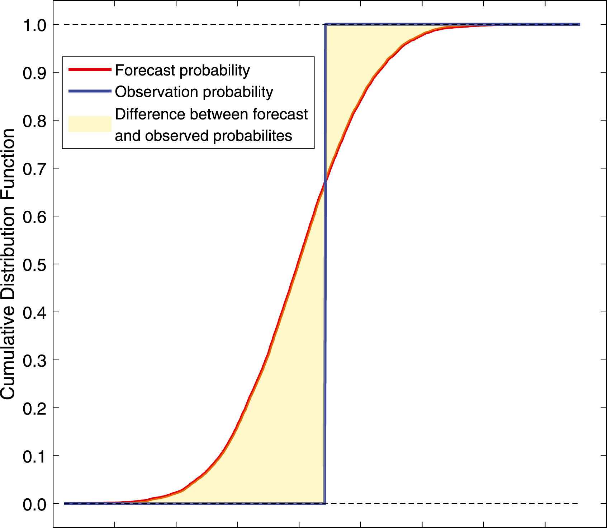

```{r}
#| label: setup
#| include: false
#| cache: false
source("setup.R")
```


# Evaluating forecast accuracy

## Evaluate forecast accuracy

* In order to evaluate the performance of a forecasting model, we compute its forecast accuracy.
* Forecast accuracy is compared by measuring errors based on the test set.
* Ideally, compare the benefit of improved accuracy with the cost of obtaining it.

## Evaluate forecast accuracy: decision impact

::::: {.callout-note}
## Best forecast = best decisions
Choose the model whose forecasts lead to better decisions, such as:

:::: {.columns}
::: {.column width="50%"}
* lower staffing costs
* lower emissions
* higher service levels
* fewer stock-outs
:::
::: {.column width="50%"}
* less excess inventory
* faster response
* more stable plans
:::
::::
:::::

::: {.fragment}
* Decision impact is often hard to measure.
* Fallback: choose the most accurate forecast.
:::

## A perfect fit

::: {.poll #perfect-fit}
A model fits the training data perfectly. Will it forecast well?

- [ ] Yes
- [x] Not necessarily
- [ ] No
:::

## In-sample (training) vs. out-of-sample (test)

* Residuals (in-sample errors) are not a reliable indication of forecast accuracy
* A model which fits the training data well will not necessarily forecast well
* A perfect fit can always be obtained by using a model with enough parameters
* Over-fitting a model to data is just as bad as failing to identify a systematic pattern in the data

## Forecast accuracy evaluation using test sets

* We mimic the real life situation
* We pretend we don't know some part of data (new data)
* It must not be used for *any* aspect of model training
* Forecast accuracy is computed only based on the test set
* The test set should ideally be at least as long as the maximum forecast horizon

## Training and test sets

```{r}
#| label: traintest
#| echo: false
#| fig-height: 1
train <- 1:18
test <- 19:24
par(mar = c(0, 0, 0, 0))
plot(0, 0, xlim = c(0, 26), ylim = c(0, 2), xaxt = "n", yaxt = "n", bty = "n", xlab = "", ylab = "", type = "n")
arrows(0, 0.5, 25, 0.5, 0.05)
points(train, train * 0 + 0.5, pch = 19, col = "blue")
points(test, test * 0 + 0.5, pch = 19, col = "red")
text(26, 0.5, "time")
text(10, 1, "Training data", col = "blue")
text(21, 1, "Test data", col = "red")
```

# Evaluating point forecast accuracy

## Forecast errors

Forecast "error": the difference between an observed value and its forecast.
$$
  e_{T+h} = y_{T+h} - \hat{y}_{T+h|T},
$$
where

* the training data is $\{y_1,\dots,y_T\}$
* $y_{T+h}$ is the $h$th test observation, $h=1,\dots,H$
* $\hat{y}_{T+h|T}$ is its forecast based on data up to time $T$

## Forecasting beer production {.code-small}

```{r}
#| label: beer-fc-1
#| output-location: slide
#| fig-height: 4
beer_fit <- aus_production |>
  filter(between(year(Quarter), 1992, 2007)) |>
  model(
    snaive = SNAIVE(Beer),
    mean = MEAN(Beer)
  )
beer_fit |>
  forecast(h = 10) |>
  autoplot(filter(aus_production, year(Quarter) >= 1990), level = NULL) +
  labs(
    title = "Forecasts for quarterly beer production",
    x = "Quarter", y = "Megalitres"
  ) +
  guides(colour = guide_legend(title = "Forecast"))
```

## Scale-dependent and percentage errors

::: {.block}
$$\begin{aligned}
\text{MAE} &= \text{mean}(|e_{T+h}|) \\
\text{MSE} &= \text{mean}(e_{T+h}^2) \\
\text{RMSE} &= \sqrt{\text{mean}(e_{T+h}^2)} \\
\text{MAPE} &= 100\,\text{mean}(|e_{T+h}|/|y_{T+h}|)
\end{aligned}$$
:::

::: {.fragment}
* MAE, MSE, RMSE are all scale dependent.
* MAPE is scale independent but is only sensible if $y_t\gg 0$ for all $t$, and $y$ has a natural zero.
:::

## Scaled errors: MASE {.smaller}

::: {.callout-note}
## Mean Absolute Scaled Error
$$
  \text{MASE} = \text{mean}(|e_{T+h}|/Q)
$$
:::

::: {.fragment}

- For non-seasonal series, scale uses naïve forecasts:

::: {.center-text}
$Q = \frac{1}{T-1}\displaystyle\sum_{t=2}^T |y_{t}-y_{t-1}|$
:::

- For seasonal series, scale uses seasonal naïve forecasts:

::: {.center-text}
$Q = \frac{1}{T-m}\displaystyle\sum_{t=m+1}^T |y_{t}-y_{t-m}|$
:::

::: {style="text-align:right"}
where $m$ is the seasonal frequency, and $Q$ is computed on the training data
:::
:::

::: {.fragment}
Proposed by Hyndman and Koehler (IJF, 2006).
:::

## Scaled errors: RMSSE {.smaller}

::: {.callout-note}
## Root Mean Squared Scaled Error
$$
  \text{RMSSE} = \sqrt{\text{mean}(e^2_{T+h}/Q)}
$$
:::

::: {.fragment}

- For non-seasonal series, scale uses naïve forecasts:

::: {.center-text}
$Q = \frac{1}{T-1}\displaystyle\sum_{t=2}^T (y_{t}-y_{t-1})^2$
:::

- For seasonal series, scale uses seasonal naïve forecasts:

::: {.center-text}
$Q = \frac{1}{T-m}\displaystyle\sum_{t=m+1}^T (y_{t}-y_{t-m})^2$
:::

::: {style="text-align:right"}
where $m$ is the seasonal frequency, and $Q$ is computed on the training data
:::
:::

::: {.fragment}
Used in the M5 forecasting competition (Makridakis et al., IJF, 2022).
:::

## Test-set accuracy {.code-small}

```{r}
#| label: beer-test-accuracy
beer_fc <- forecast(beer_fit, h = 10)
beer_fc |>
  accuracy(
    aus_production,
    measures = list(RMSE = RMSE, MAE = MAE, MAPE = MAPE, MASE = MASE, RMSSE = RMSSE)
  )
```

::: {.fragment}
* Seasonal naïve beats the mean on every measure.
* Its MASE and RMSSE are below 1: smaller errors than in-sample seasonal naïve.
:::

# Evaluating distributional forecast accuracy

## Prediction interval accuracy using Winkler score

Winkler (1972) proposed a scoring method to enable comparisons between prediction intervals:

- it takes account of both coverage and width of the intervals.

::: {.callout-note}
## Winkler score
$$\begin{aligned}
  W(l_t,u_t,y_t) =
    \begin{cases}
      u_t-l_t & \text{if $l_t \le y_t \le u_t$}\\
      (u_t-l_t)+ \frac{2}{\alpha}(l_t-y_t) & \text{if $y_t < l_t$}\\
      (u_t-l_t) + \frac{2}{\alpha}(y_t-u_t) & \text{if $y_t > u_t$}
    \end{cases}
\end{aligned}$$
:::

where $[l_t, u_t]$ is a $100(1-\alpha)\%$ prediction interval.

* Lower is better.
* Misses are penalised by $2/\alpha$ times the distance outside the interval.

## Prediction interval accuracy {.code-small}

```{r}
#| label: winkler-accuracy
beer_fc |>
  accuracy(aus_production, measures = list(winkler = winkler_score), level = 95)
```

::: {.fragment}
* Winkler scores for 95% prediction intervals ($\alpha = 0.05$).
* Both cover every test observation, but seasonal naïve intervals are half as wide.
:::


## Quantile score

::: {.callout-note}
## Quantile score
$$\begin{aligned}
  Q_{p,t} =
    \begin{cases}
    2(1 - p) \big(f_{p,t} - y_{t}\big), & \text{if $y_{t} < f_{p,t}$}\\
    2p \big(y_{t} - f_{p,t}\big), & \text{if $y_{t} \ge f_{p,t}$}
    \end{cases}
\end{aligned}$$
:::

where $f_{p,t}$ is the $p$-quantile of the forecast distribution for time $t$.

* Lower is better.

## Quantile score {.code-small}

```{r}
#| label: qs-accuracy
beer_fc |>
  accuracy(aus_production, list(qs = quantile_score), probs = 0.9)
```

::: {.fragment}
* Quantile score of the 90th percentile forecasts ($p = 0.9$).
:::

## Continuous Ranked Probability Score (CRPS)

$$\large \text{CRPS} = \text{mean}(p_t),$$

where

$$p_t = \int_{-\infty}^{\infty} \left(G_t(x) - F_t(x)\right)^2dx$$

* $G_t(x)$ is the forecast distribution function for time $t$
* $F_t(x)$ is the observation's distribution function: a step from 0 to 1 at $y_t$
* Lower is better; for a point forecast it reduces to the MAE.

## Continuous Ranked Probability Score (CRPS)

```{r}
#| label: crps
#| echo: false
#| out-width: 60%

```

## Percentile score and CRPS {.code-small}

```{r}
#| label: qs-crps-accuracy
beer_fc |>
  accuracy(aus_production, measures = distribution_accuracy_measures)
```

::: {.fragment}
* Percentile score: quantile score averaged over $p = 0.01, 0.02, \dots, 0.99$.
* Seasonal naïve has the better distributional forecasts on both measures.
:::
