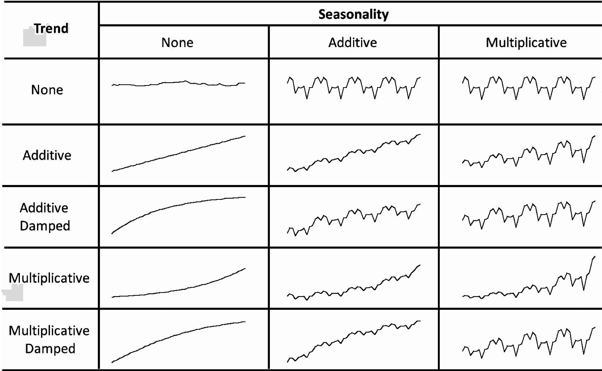

```{r}
#| label: setup
#| include: false
#| cache: false
source("setup.R")
library(fpp3)
```

# Exponential smoothing

## From simple methods to Exponential Smoothing

* Naive method: Use only the last observation.
* Average method: Use all observations.
* Want something in between naive and average methods.
* Most recent data should have more weight.
* This is exactly the concept behind exponential smoothing.

## Pegels' classification

```{r pegel1,echo=FALSE, out.width='90%', fig.align='center'}

```

## Historical perspective

* Developed in the 1950s and 1960s as methods (algorithms) to produce point forecasts.
* Combine a "level", "trend" (slope) and "seasonal" component to describe a time series.
* The rate of change of the components are controlled by "smoothing parameters": $\alpha$, $\beta$ and $\gamma$ respectively.
* Need to choose best values for the smoothing parameters (and initial states).
* Equivalent ETS state space models developed in the 1990s and 2000s.

## A model for levels, trends, and seasonalities

We want a model that captures the level ($\ell_t$), trend ($b_t$) and seasonality ($s_t$).

[How do we combine these elements?]{.alert}

::: {.fragment}
::: {.callout-note}
## Additively?
$y_t = \ell_{t-1} + b_{t-1} + s_{t-m} + \varepsilon_t$
:::
:::

::: {.fragment}
::: {.callout-note}
## Multiplicatively?
$y_t = \ell_{t-1}b_{t-1}s_{t-m}(1 + \varepsilon_t)$
:::
:::

::: {.fragment}
::: {.callout-note}
## Perhaps a mix of both?
$y_t = (\ell_{t-1} + b_{t-1}) s_{t-m} + \varepsilon_t$
:::
:::

::: {.fragment}
[How do the level, trend and seasonal components evolve over time?]{.alert}
:::

## ETS models

::: {.block .center-text}
**General notation** &nbsp;&nbsp; E T S : &nbsp;**E**xpon**e**n**T**ial **S**moothing

| | | |
|:---:|:---:|:---:|
| $\nearrow$ | $\uparrow$ | $\nwarrow$ |
| **E**rror | **T**rend | **S**eason |
:::

[**E**rror:]{.alert} Additive (`"A"`) or multiplicative (`"M"`)

::: {.fragment}
[**T**rend:]{.alert} None (`"N"`), additive (`"A"`), multiplicative (`"M"`), or damped (`"Ad"` or `"Md"`).
:::

::: {.fragment}
[**S**easonality:]{.alert} None (`"N"`), additive (`"A"`) or multiplicative (`"M"`)
:::

## ETS(A,N,N): SES with additive errors

::: {.block}
$$\begin{aligned}
\text{Forecast equation}&& \hat{y}_{T+h|T} &= \ell_T \\
\text{Measurement equation}&& y_t &= \ell_{t-1} + \varepsilon_t\\
\text{State equation}&& \ell_t&=\ell_{t-1}+\alpha \varepsilon_t
\end{aligned}$$
:::

where $\varepsilon_t\sim\text{NID}(0,\sigma^2)$.

::: {.fragment}
  * "innovations" or "single source of error" because equations have the same error process, $\varepsilon_t$.
  * Measurement equation: relationship between observations and states.
  * Transition/state equation(s): evolution of state(s) over time.
:::


## ETS(M,N,N): SES with multiplicative errors

::: {.block}
$$\begin{aligned}
\text{Forecast equation}&& \hat{y}_{T+h|T} &= \ell_T \\
\text{Measurement equation}&& y_t &= \ell_{t-1}(1 + \varepsilon_t)\\
\text{State equation}&& \ell_t&=\ell_{t-1} (1+\alpha\varepsilon_t)
\end{aligned}$$
:::

where $\varepsilon_t\sim\text{NID}(0,\sigma^2)$.

::: {.fragment}
  * Models with additive and multiplicative errors with the same parameters generate the same point forecasts but different prediction intervals.
:::


# Trend methods

## Holt's linear trend

::: {.callout-note}
## Additive errors: ETS(A,A,N)
$$\begin{aligned}
\text{Forecast equation}&& \hat{y}_{T+h|T} &= \ell_T + hb_T\\
\text{Measurement equation}&& y_t &= \ell_{t-1}+b_{t-1}+\varepsilon_t\\
\text{State equations}&&       \ell_t&=\ell_{t-1}+b_{t-1}+\alpha \varepsilon_t\\
&&      b_t&=b_{t-1}+\beta \varepsilon_t
\end{aligned}$$
:::

::: {.fragment}
::: {.callout-note}
## Multiplicative errors: ETS(M,A,N)
$$\begin{aligned}
\text{Forecast equation}&& \hat{y}_{T+h|T} &= \ell_T + hb_T\\
\text{Measurement equation}&& y_t &= (\ell_{t-1}+b_{t-1})(1+\varepsilon_t)\\
\text{State equations}&&       \ell_t&=(\ell_{t-1}+b_{t-1})(1+\alpha \varepsilon_t)\\
&&      b_t&=b_{t-1}+\beta (\ell_{t-1}+b_{t-1})\varepsilon_t
\end{aligned}$$
:::
:::

## Example: Australian population


```{r holt-fit, echo=TRUE}
aus_economy <- global_economy |>
  filter(Country == "Australia") |>
  mutate(Pop = Population / 1e6)
fit <- aus_economy |>
  model(AAN = ETS(Pop ~ error("A") + trend("A") + season("N")))
report(fit)
```

## Example: Australian population


```{r holt-cmp, echo=TRUE, dependson='holt-fit'}
components(fit)
```

## Example: Australian population


```{r holt-cmp-plot, echo=TRUE, dependson='holt-fit', fig.height=4.5}
components(fit) |> autoplot()
```

## Example: Australian population


```{r holt-fc, echo=TRUE, dependson='holt-fit', fig.height=3.4}
fit |>
  forecast(h = 20) |>
  autoplot(aus_economy) +
  labs(y = "Population", x = "Year")
```

## ETS(A,Ad,N): Damped trend method

::: {.callout-note}
## Additive errors
$$\begin{aligned}
\text{Forecast equation}&& \hat{y}_{T+h|T} &= \ell_T + (\phi + \phi^2 + \cdots + \phi^{h})b_T\\
\text{Measurement equation}&& y_t &= (\ell_{t-1}+\phi b_{t-1})+\varepsilon_t\\
\text{State equations}&&       \ell_t&=(\ell_{t-1}+\phi b_{t-1})+\alpha \varepsilon_t\\
&&      b_t&=\phi b_{t-1}+\beta \varepsilon_t
\end{aligned}$$
:::

::: {.fragment}
  * Damping parameter $0<\phi\le 1$.
  * If $\phi=1$, identical to Holt's linear trend.
  * As $h\rightarrow\infty$, $\pred{y}{T+h}{T}\rightarrow \ell_T+\phi b_T/(1-\phi)$.
  * Short-run forecasts trended, long-run forecasts constant.
:::

## Example: Australian population

```{r, echo=TRUE, fig.height=3.4}
aus_economy |>
  model(damped = ETS(Pop ~ error("A") + trend("Ad") + season("N"))) |>
  forecast(h = 20) |>
  autoplot(aus_economy)
```

## Example: Nigerian population {.code-small}

:::: {.columns}
::: {.column width="68%"}
```{r nigeria-aicc, echo=TRUE, eval=FALSE}
global_economy |>
  filter(Country == "Nigeria") |>
  mutate(Pop = Population / 1e6) |>
  model(
    ANN = ETS(Pop ~ error("A") + trend("N") + season("N")),
    AAN = ETS(Pop ~ error("A") + trend("A") + season("N")),
    AAdN = ETS(Pop ~ error("A") + trend("Ad") + season("N"))
  ) |>
  glance() |>
  select(.model, AICc)
```
:::

::: {.column width="32%"}
```{r nigeria-aicc-output, ref.label="nigeria-aicc", echo=FALSE}
```
:::
::::

::: {.poll #nigeria-best-ets}
Which ETS model is best for Nigeria's population?

- [ ] ETS(A,N,N)
- [x] ETS(A,A,N)
- [ ] ETS(A,Ad,N)
:::

## Example: National populations


```{r popfit, echo=TRUE}
fit <- global_economy |>
  mutate(Pop = Population / 1e6) |>
  model(ets = ETS(Pop))
fit
```

## Example: National populations {.code-small}

```{r popfc, echo=TRUE, dependson="popfit"}
fit |>
  forecast(h = 5)
```


# Seasonal methods

## ETS(A,A,A): Holt-Winters additive method

::: {.block}
$$\begin{aligned}
\text{Forecast equation} && \hat{y}_{T+h|T} &= \ell_{T} + hb_{T} + s_{T+h-m(k+1)}\\
\text{Measurement equation}&& y_t&=\ell_{t-1}+b_{t-1}+s_{t-m} + \varepsilon_t\\
\text{State equations}&& \ell_t&=\ell_{t-1}+b_{t-1}+\alpha \varepsilon_t\\
&&        b_t&=b_{t-1}+\beta \varepsilon_t \\
&&s_t &= s_{t-m} + \gamma\varepsilon_t
\end{aligned}$$
:::

* $k=$ integer part of $(h-1)/m$.
* $\sum_i s_i \approx 0$.
* Parameters:&nbsp; $0\le \alpha\le 1$,&nbsp; $0\le \beta\le \alpha$,&nbsp; $0\le \gamma\le 1-\alpha$&nbsp;  and $m=$  period of seasonality (e.g. $m=4$ for quarterly data).

## ETS(M,A,M): Holt-Winters multiplicative method

::: {.block}
$$\begin{aligned}
\text{Forecast equation} && \hat{y}_{T+h|T} &= (\ell_{T} + hb_{T}) s_{T+h-m(k+1)}\\
\text{Measurement equation}&& y_t&= (\ell_{t-1}+b_{t-1})s_{t-m}(1 + \varepsilon_t)\\
\text{State equations}&& \ell_t&=(\ell_{t-1}+b_{t-1})(1+\alpha \varepsilon_t)\\
&&        b_t&=b_{t-1}+\beta(\ell_{t-1}+b_{t-1})\varepsilon_t \\
&&s_t &= s_{t-m}(1 + \gamma\varepsilon_t)
\end{aligned}$$
:::

* $k$ is integer part of $(h-1)/m$.
* $\sum_i s_i \approx m$.
* Parameters:&nbsp; $0\le \alpha\le 1$,&nbsp; $0\le \beta\le \alpha$,&nbsp; $0\le \gamma\le 1-\alpha$&nbsp;  and $m=$  period of seasonality (e.g. $m=4$ for quarterly data).

## Example: Australian holiday tourism


```{r ausholidays-fit, echo=TRUE}
holidays <- tourism |>
  filter(Purpose == "Holiday")
fit <- holidays |> model(ets = ETS(Trips))
fit
```

## Example: Australian holiday tourism {.nostretch}

```{r ausholidays-snowy-plot, echo=FALSE, fig.height=2}
holidays |>
  filter(Region == "Snowy Mountains") |>
  autoplot(Trips) +
  labs(y = "Thousands", title = "Snowy Mountains holiday trips")
```

::: {.poll #snowy-ets-pattern}
Which ETS model suits Snowy Mountains holiday trips?

- [ ] ETS(?,A,A)
- [x] ETS(?,N,A)
- [ ] ETS(?,N,M)
- [ ] ETS(?,N,N)
:::

## Example: Australian holiday tourism


```{r ausholidays-report}
fit |>
  filter(Region == "Snowy Mountains") |>
  report()
```

## Example: Australian holiday tourism


```{r ausholidays-components}
fit |>
  filter(Region == "Snowy Mountains") |>
  components()
```

## Example: Australian holiday tourism


```{r ausholidays-components-plot}
#| fig-height: 3.6
fit |>
  filter(Region == "Snowy Mountains") |>
  components() |>
  autoplot()
```

## Example: Australian holiday tourism


```{r ausholidays-forecast}
fit |> forecast()
```

## Example: Australian holiday tourism


```{r ausholidays-forecast-plot, fig.height=3.4}
fit |>
  forecast() |>
  filter(Region == "Snowy Mountains") |>
  autoplot(holidays) +
  labs(x = "Quarter", y = "Overnight trips (thousands)")
```

# ETS taxonomy

## Exponential smoothing models

::: {.block}
| **Additive Error** | | N | A | M |
|:--|:--|:-:|:-:|:-:|
| **Trend Component** | | **(None)** | **(Additive)** | **(Multiplicative)** |
| N | (None) | A,N,N | A,N,A | ~~A,N,M~~ |
| A | (Additive) | A,A,N | A,A,A | ~~A,A,M~~ |
| A$_\text{d}$ | (Additive damped) | A,A$_\text{d}$,N | A,A$_\text{d}$,A | ~~A,A$_\text{d}$,M~~ |
:::

::: {.block}
| **Multiplicative Error** | | N | A | M |
|:--|:--|:-:|:-:|:-:|
| **Trend Component** | | **(None)** | **(Additive)** | **(Multiplicative)** |
| N | (None) | M,N,N | M,N,A | M,N,M |
| A | (Additive) | M,A,N | M,A,A | M,A,M |
| A$_\text{d}$ | (Additive damped) | M,A$_\text{d}$,N | M,A$_\text{d}$,A | M,A$_\text{d}$,M |
:::

## Estimating ETS models

  * Smoothing parameters $\alpha$, $\beta$, $\gamma$ and $\phi$, and the initial states $\ell_0$, $b_0$, $s_0,s_{-1},\dots,s_{-m+1}$ are estimated by maximising the "likelihood" = the probability of the data arising from the specified model.
  * For models with additive errors equivalent to minimising SSE.
  * For models with multiplicative errors, **not** equivalent to minimising SSE.

## Model selection {.smaller}

::: {.callout-note}
## Akaike's Information Criterion
$$\text{AIC} = -2\log(L) + 2k$$
:::

where $L$ is the likelihood and $k$ is the number of parameters and initial states estimated in the model.

::: {.fragment}
::: {.callout-note}
## Corrected AIC
$$\text{AIC}_{\text{c}} = \text{AIC} + \frac{2k(k+1)}{T-k-1}$$
:::

which is the AIC corrected (for small sample bias).
:::

::: {.fragment}
::: {.callout-note}
## Bayesian Information Criterion
$$\text{BIC} = \text{AIC} + k(\log(T)-2).$$
:::
:::

## AIC and cross-validation

::: {.alertblock style="font-size:1.3em"}
Minimising the AIC assuming Gaussian residuals is asymptotically equivalent to minimising one-step time series cross validation MSE.
:::

Time series cross-validation is covered on Day 5.

## Automatic forecasting

**From Hyndman et al. (IJF, 2002):**

1. Apply each model that is appropriate to the data.
Optimise parameters and initial values using MLE.
1. Select best method using AICc.
1. Produce forecasts using best method.
1. Obtain forecast intervals using underlying state space model.

* Method performed very well in M3 competition.
* Used as a benchmark in the M4 competition.


# Non-Gaussian forecast distributions

## Non-Gaussian forecast distributions {.code-small}

```{r cafe, fig.height=3.1}
vic_cafe <- aus_retail |>
  filter(State == "Victoria",
         Industry == "Cafes, restaurants and catering services") |>
  select(Month, Turnover)
vic_cafe |>
  autoplot(Turnover) +
  labs(title = "Monthly turnover of Victorian cafes", y = "Turnover ($AUD million)")
```

## Forecasting with transformations {.code-small}

```{r}
vic_cafe |> autoplot(box_cox(Turnover, lambda = 0.2))
```

## Forecasting with transformations {.code-small}

```{r cafe-log-aicc}
#| output-location: column
vic_cafe |>
  model(
    raw = ETS(Turnover),
    log = ETS(log(Turnover))
  ) |>
  glance() |>
  select(.model, AICc)
```

::: {.poll #cafe-log-aicc}
Which model is better for Victorian cafe turnover?

- [ ] ETS(log(Turnover))
- [ ] ETS(Turnover)
- [x] Can't tell from AICc
:::

## Forecasting with transformations {.code-small}

```{r}
fit <- vic_cafe |>
  model(ets = ETS(box_cox(Turnover, 0.2)))
fit
```

```{r include=FALSE}
if (!identical(fabletools:::model_sum(fit$ets[[1]]), "ETS(A,A,A)")) {
  stop("Model not ETS(A,A,A)")
}
```

```{r}
(fc <- fit |> forecast(h = "3 years"))
```

::: {.alertblock .fragment .absolute top="420px" right="0px" width="440px"}
* `t(N)` denotes a transformed normal distribution.
* The distribution is back-transformed and the mean (`.mean`) is bias-adjusted automatically.
:::

## Forecasting with transformations {.code-small}

```{r}
fc |> autoplot(vic_cafe)
```

## Bootstrapped forecast distributions {.code-small}

```{r}
sim <- fit |> generate(h = "3 years", times = 5, bootstrap = TRUE)
sim
```

## Bootstrapped forecast distributions {.code-small}

```{r, fig.height=2.7}
vic_cafe |>
  filter(year(Month) >= 2008) |>
  ggplot(aes(x = Month)) +
  geom_line(aes(y = Turnover)) +
  geom_line(aes(y = .sim, colour = as.factor(.rep)), data = sim) +
  labs(title = "Monthly turnover of Victorian cafes") +
  guides(colour = "none")
```

## Bootstrapped forecast distributions {.code-small}

```{r}
fc <- fit |> forecast(h = "3 years", bootstrap = TRUE)
fc
```

## Bootstrapped forecast distributions {.code-small}

```{r}
fc |> autoplot(vic_cafe) +
  labs(title = "Monthly turnover of Victorian cafes")
```
