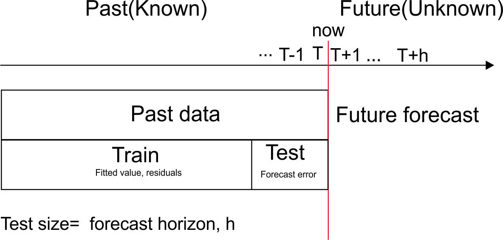
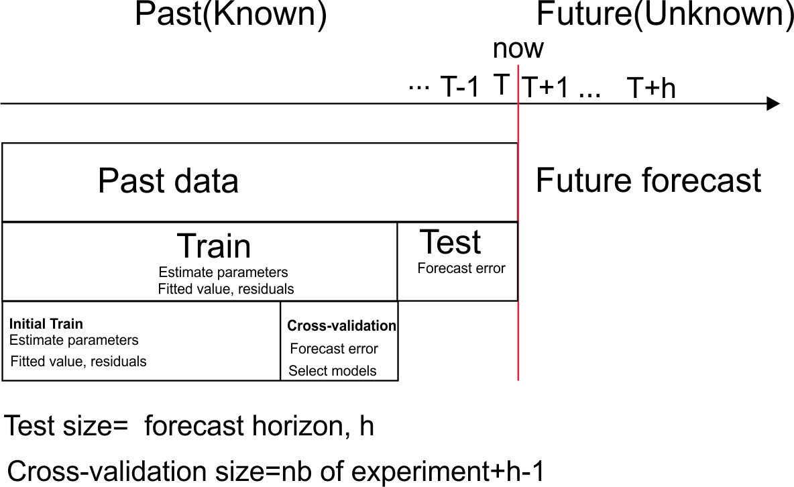

```{r}
#| label: setup
#| include: false
#| cache: false
source("setup.R")
# gg_tsresiduals() has moved from feasts to ggtime
library(ggtime)
antidiabetic_drug_sale <- PBS |>
  filter(ATC2 == "A10") |>
  summarise(Cost = sum(Cost) / 1e6) |>
  filter(year(Month) >= 2000)

# Animations of the windows made by rolling a tsibble
for (f in c("common/morph.R", "roll.R")) {
  source(file.path("R", "morph", f))
}
```


# Time series cross-validation

## Issue with traditional train/test split 

```{r}
#| label: f-test
#| echo: false
#| out-width: 90%

```

## Forecasting from a rolling origin

```{r}
#| label: f-future
#| echo: false

```

## Time series cross-validation

```{r}
#| label: cv-diagram
#| echo: false
#| fig-height: 3
par(mar=c(0,0,0,0))
plot(0,0,xlim=c(0,28),ylim=c(0,1),
       xaxt="n",yaxt="n",bty="n",xlab="",ylab="",type="n")
i <- 1
for(j in 1:10)
{
  test <- (16+j):26
  train <- 1:(15+j)
  arrows(0,1-j/20,27,1-j/20,0.05)
  points(train,rep(1-j/20,length(train)),pch=19,col="blue")
  if(length(test) >= i)
    points(test[i], 1-j/20, pch=19, col="red")
  if(length(test) >= i)
    points(test[-i], rep(1-j/20,length(test)-1), pch=19, col="gray")
  else
    points(test, rep(1-j/20,length(test)), pch=19, col="gray")
}
text(28,.95,"time")
```

::: {.fragment}
* Forecast accuracy averaged over test sets.
* Also known as "evaluation on a rolling forecasting origin"
:::

## Creating the rolling training sets

Three functions roll a tsibble into windows, numbered by a new `.id` column.

* `stretch_tsibble()`: extends a growing window with new data.
* `slide_tsibble()`: shifts a fixed length window through the data.
* `tile_tsibble()`: moves a fixed length window without overlap.

For time series cross-validation, stretching windows are most commonly used.

## Stretch: `stretch_tsibble()` {.code-small}

```{r}
#| label: roll-stretch
x <- tsibble(t = 1:20, index = t)
stretch <- x |> stretch_tsibble(.init = 6, .step = 2)
```

:::::: {.morph-slide}

```{r}
#| label: roll-stretch-morph
#| echo: false
#| output: asis
#| cache: false
roll_morph(
  stretch, n = 20, id = "roll-stretch-morph",
  alt = "Animation adding the windows made by stretch_tsibble() one at a time, each starting at the first observation and two observations longer than the last."
)
```

::::: {.morph-captions}

:::: {.morph-step}
A tsibble `x` of 20 observations.
::::

:::: {.morph-step .fragment .fade-in-then-out}
The first window holds the first `.init = 6` observations.
::::

:::: {.morph-step .fragment .fade-in-then-out}
The next window adds `.step = 2` observations.
::::

:::: {.morph-step .fragment .fade-in-then-out}
Keep growing until the window reaches the end of the data: 8 windows, numbered by `.id`.
::::

:::::

::::::

## Slide: `slide_tsibble()` {.code-small}

```{r}
#| label: roll-slide
#| dependson: roll-stretch
slide <- x |> slide_tsibble(.size = 8, .step = 2)
```

:::::: {.morph-slide}

```{r}
#| label: roll-slide-morph
#| echo: false
#| output: asis
#| cache: false
roll_morph(
  slide, n = 20, id = "roll-slide-morph",
  alt = "Animation adding the windows made by slide_tsibble() one at a time, each eight observations long and starting two observations after the last."
)
```

::::: {.morph-captions}

:::: {.morph-step}
A tsibble `x` of 20 observations.
::::

:::: {.morph-step .fragment .fade-in-then-out}
The first window holds the first `.size = 8` observations.
::::

:::: {.morph-step .fragment .fade-in-then-out}
The next window moves along by `.step = 2` observations, keeping its size.
::::

:::: {.morph-step .fragment .fade-in-then-out}
Keep sliding until the window reaches the end of the data: 7 windows.
::::

:::::

::::::

## Tile: `tile_tsibble()` {.code-small}

```{r}
#| label: roll-tile
#| dependson: roll-stretch
tile <- x |> tile_tsibble(.size = 5)
```

:::::: {.morph-slide}

```{r}
#| label: roll-tile-morph
#| echo: false
#| output: asis
#| cache: false
roll_morph(
  tile, n = 20, id = "roll-tile-morph",
  alt = "Animation adding the windows made by tile_tsibble() one at a time, each five observations long and starting where the last ended."
)
```

::::: {.morph-captions}

:::: {.morph-step}
A tsibble `x` of 20 observations.
::::

:::: {.morph-step .fragment .fade-in-then-out}
The first tile holds the first `.size = 5` observations.
::::

:::: {.morph-step .fragment .fade-in-then-out}
The next tile starts where the last ended, so the tiles never overlap.
::::

:::: {.morph-step .fragment .fade-in-then-out}
Keep tiling until the data are used up: 4 tiles.
::::

:::::

::::::

## Rolling origins for drug sales {.code-small}

Monthly antidiabetic drug sales in Australia (\$ millions), from 2000.
Stretch with a minimum length of 24, growing by 1 each step.

```{r}
#| label: cv-stretch
forecast_horizon <- 12
test <- antidiabetic_drug_sale |> 
  slice((n()-forecast_horizon+1):n())
train <- antidiabetic_drug_sale |> 
  slice(1:(n()-forecast_horizon))
drug_sale_tcsv <- train |>
  stretch_tsibble(.init = 24, .step = 1)
```

```{r}
#| label: cv-stretch-print
#| echo: false
drug_sale_tcsv |> print(n = 4)
```

## Fit models to each window {.code-small}

Estimate seasonal naïve, naïve and drift models for each window.

```{r}
#| label: cv-fit
drug_fit_tr <- drug_sale_tcsv |> 
  model(
    snaive = SNAIVE(Cost),
    naive = NAIVE(Cost),
    drift = RW(Cost ~ drift())
  )
```

```{r}
#| label: cv-fit-print
#| echo: false
print(drug_fit_tr, n = 4)
```

## Forecasts from each window {.code-small}

Produce 12-step-ahead forecasts from each model and window.

```{r}
#| label: cv-fc
drug_fc_tr <- drug_fit_tr |> 
  forecast(h = forecast_horizon)
```

```{r}
#| label: cv-fc-print
#| echo: false
drug_fc_tr |> print(n = 4)
```

## Which method will win?

::: {.poll #cv-winner}
Which method do you expect to forecast antidiabetic drug sales best?

- [x] Seasonal naïve
- [ ] Naïve
- [ ] Drift
:::

## Cross-validated accuracy {.code-small}

```{r}
#| label: cv-accuracy
drug_fc_tr |>
  accuracy(
    antidiabetic_drug_sale,
    measures = list(
      point_accuracy_measures,
      interval_accuracy_measures,
      distribution_accuracy_measures
    )
  ) |>
  select(.model, RMSE, MAE, MASE, winkler, CRPS)
```

Errors are averaged over all origins and all 12 horizons.

## From cross-validation to forecasts

::: {.poll #after-cv}
Seasonal naïve wins the cross-validation. How do you produce the forecasts you deliver?

- [ ] Use the forecasts from the last window
- [x] Refit seasonal naïve on all the data
- [ ] Average the forecasts from every window
:::


# Residual diagnostics

## Forecasting residuals

::: {.block}
**Residuals in forecasting:** difference between observed value and its fitted value (one-step forecast) on the training data: $e_t = y_t-\hat{y}_{t|t-1}$.
:::

::: {.fragment}
[Assumptions]{.alert}

1. $\{e_t\}$ uncorrelated. If they aren't, then information left in residuals that should be used in computing forecasts.
2. $\{e_t\}$ have mean zero. If they don't, then forecasts are biased.
:::

::: {.fragment}
[Useful properties]{.alert} (for prediction intervals)

3. $\{e_t\}$ have constant variance.
4. $\{e_t\}$ are normally distributed.
:::

## Facebook closing stock price

```{r}
#| label: fb-stock
fb_stock <- gafa_stock |>
  filter(Symbol == "FB")
fb_stock |>
  autoplot(Close) +
  labs(x = "Date", y = "Closing price (US$)")
```

## Naïve model of Facebook's stock price {.code-small}

```{r}
#| label: fb-augment
fb_stock <- fb_stock |>
  mutate(trading_day = row_number()) |>
  update_tsibble(index = trading_day, regular = TRUE)
fit <- fb_stock |> model(NAIVE(Close))
augment(fit)
```

## Fitted values

```{r}
#| label: fb-fitted
#| dependson: fb-augment
#| fig-height: 3.4
augment(fit) |>
  ggplot(aes(x = trading_day)) +
  geom_line(aes(y = Close, colour = "Data")) +
  geom_line(aes(y = .fitted, colour = "Fitted")) +
  labs(x = "Trading day", y = "Closing price (US$)", colour = NULL)
```

## Fitted values (last 158 trading days)

```{r}
#| label: fb-fitted-zoom
#| dependson: fb-augment
#| fig-height: 3.4
augment(fit) |>
  filter(trading_day > 1100) |>
  ggplot(aes(x = trading_day)) +
  geom_line(aes(y = Close, colour = "Data")) +
  geom_line(aes(y = .fitted, colour = "Fitted")) +
  labs(x = "Trading day", y = "Closing price (US$)", colour = NULL)
```

## Residuals over time

```{r}
#| label: fb-resid
#| dependson: fb-augment
augment(fit) |>
  autoplot(.resid) +
  labs(x = "Trading day", y = "Residual", title = "Residuals from naïve method")
```

## Histogram of residuals

```{r}
#| label: fb-resid-hist
#| dependson: fb-augment
#| fig-height: 3.4
augment(fit) |>
  ggplot(aes(x = .resid)) +
  geom_histogram(bins = 150) +
  labs(x = "Residual", y = "Count", title = "Histogram of residuals")
```

## ACF of residuals

```{r}
#| label: fb-resid-acf
#| dependson: fb-augment
augment(fit) |>
  ACF(.resid) |>
  autoplot() +
  labs(x = "Lag", y = "ACF", title = "ACF of residuals")
```

## Checking the ACF of residuals

* We assume that the residuals are white noise (uncorrelated, mean zero, constant variance). If they aren't, then there is information left in  the residuals that should be used in computing forecasts.

* So a standard residual diagnostic is to check the ACF of the residuals of a forecasting method.

* We *expect* these to look like white noise.

## Combined diagnostic graph

```{r}
#| label: fb-tsresiduals
#| eval: false
fit |> gg_tsresiduals()
```

```{r}
#| label: fb-tsresiduals-plot
#| dependson: fb-augment
#| echo: false
p <- gg_tsresiduals(fit) + labs(x = "Trading day", y = "Residual")
p[[2]] <- p[[2]] + labs(x = "Lag", y = "ACF")
p[[3]] <- p[[3]] + labs(x = "Residual", y = "Count")
p
```

## Ljung-Box test

Test whether *whole set* of $r_{k}$ values is significantly different from zero set.

::: {.block}
::: {.center-text}
$\displaystyle Q = T(T+2) \sum_{k=1}^\ell (T-k)^{-1}r_k^2$ $\qquad$ where $\ell=$ max lag and $T=$ # observations
:::
:::

* If each $r_k$ close to zero, $Q$ will be **small**.
* If some $r_k$ values large ($+$ or $-$), $Q$ will be **large**.
* Suggested lags: $\ell=10$ for non-seasonal data, $\ell=2m$ for seasonal data (but at most $T/5$).
* If data are WN and $T$ large, $Q \sim \chi^2$ with $\ell$ degrees of freedom.
* For residuals of a model with $K$ estimated parameters, use $\ell - K$ degrees of freedom (`dof` argument).

## Ljung-Box test of the naïve residuals {.code-small}


```{r}
#| label: fb-lb-acf
#| dependson: fb-augment
#| echo: false
#| fig-height: 1.65
augment(fit) |>
  ACF(.resid, lag_max = 10) |>
  autoplot() +
  labs(x = "Lag", y = "ACF", title = "ACF of residuals")
```

```{r}
#| label: fb-ljung-box
#| dependson: fb-augment
augment(fit) |> features(.resid, ljung_box, lag = 10)
```

$p = 0.276 > 0.05$: no evidence against white noise.

## What the residuals tell us

* Mean close to zero: the forecasts are unbiased.
* Uncorrelated: no information is left in the residuals.
* Variance is not constant: it grows later in the series.
* Heavy tails and a large outlier: the residuals are not normal.

::: {.fragment}
The point forecasts are fine, but the prediction intervals may be inaccurate.
:::


# Recap

## Recap

* **Time series cross-validation** averages forecast accuracy over many rolling origins, not a single test set.
* Roll the training data into windows with `stretch_tsibble()`, fit models to each window, forecast and compare with `accuracy()`.
* **Residual diagnostics** check that the best model's residuals are uncorrelated with mean zero, and ideally have constant variance and are normal.
* Check them with `gg_tsresiduals()` and the Ljung-Box test before forecasting.
