## Foundation models

::: {.wordcloud #foundation-models-known max-words=2 max-answers=3}
Which time series foundation models have you heard of?
:::

# Introduction

## Can a pretrained model forecast our tourism series?

We want forecasts for the next four quarters of Snowy Mountains holiday travel.

::: {.callout-note}
## What changes in this session?
We start with a model that has already learned from many time series.
:::

1. Supply the tourism history.
2. Examine the forecasts and their errors.
3. Try adapting the model to this history.

## ETS: same method, different fitted models

We use the same fitting method, but learn from each region's history separately.

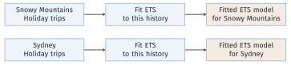{width="100%"}

::: {.callout-note}
## What changes with a foundation model?
We can reuse a model already trained on many series, then supply our tourism history to obtain a forecast.
:::

## What is a foundation model?

::: {.callout-note}
## Train broadly, then reuse
A foundation model is trained on large, varied data so that it can be reused for a range of tasks and settings.
:::

* The initial training is called **pretraining**.
* For forecasting, this training uses a collection of time series.
* We supply our tourism history and ask the trained model for the next four quarters.

## Four characteristics to remember

::: columns
::: {.column width="50%"}
::: {.block}
**1. Large, varied training data**\
Learn from many examples and settings.
:::
::: {.alertblock}
**3. Reusable across tasks**\
Apply the trained model to different series.
:::
:::
::: {.column width="50%"}
::: {.block}
**2. Often many parameters**\
Learned numbers store the model's behaviour.
:::
::: {.alertblock}
**4. Can be adapted**\
Further training can tailor it to our data.
:::
:::
:::

These features make reuse possible. They do not guarantee the best forecast for every series.

## Attention combines information from the history

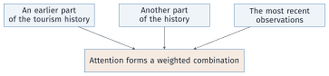{width="100%"}

* Different parts of the history can receive different weights.
* A **transformer** uses attention and neural-network layers to process this information.

## Two common routes to foundation-model forecasting

::: {.callout-note}
## 1. Models built for time series
Learn from collections of time series, then forecast a new series.
:::

TimeGPT, Chronos-2, TimesFM and Moirai follow this route.

::: {.callout-note}
## 2. Language models adapted for forecasting
Start with a pretrained language model and adapt how time-series inputs and forecasts are represented.
:::

Examples: PromptCast and Time-LLM. Our code uses the first route.

## Advantages and disadvantages

| Advantages | Disadvantages |
|---|---|
| Use out-of-the-box forecasting pipelines | Privacy concerns |
| Can generate forecasts with few data points | No control of model's capabilities |
| Require less forecasting expertise | May not be optimal for every use case |
| Reusable across tasks | High resource requirements |

::: {.callout-note}
## For our tourism example
Getting a forecast is easier. We still need to check whether it is useful.
:::

# Transfer learning

## Pretraining and forecasting are separate stages

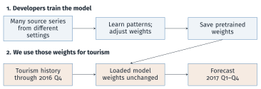{width="100%"}

Using a model learned from other series is **transfer learning**.

## What makes building a foundation model difficult?

| Challenge | What the model developer must handle |
|---|---|
| Different frequencies and domains | Quarterly tourism and hourly energy demand have different patterns. |
| Different forecast horizons | One week means 7 daily values or 168 hourly values. |
| Training resources | Large-scale training takes time, memory and often GPUs. |
| Enough varied training data | Open time-series data can be scarce; combining sources takes work. |

::: {.callout-note}
## Why start with pretrained weights?
We can reuse that training effort, then test the model on our own task.
:::

## Zero-shot or fine-tuning: what changes?

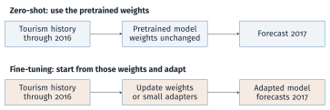{width="100%"}

Both use tourism history. Neither is allowed to learn from the 2017 test observations.

# Overview of foundation models

## Comparing foundation forecasting models

| Model | Architecture | Input representation | Forecast output |
|---|---|---|---|
| TimeGPT-1 | Encoder–decoder | History and positions | Point and intervals (API) |
| Chronos-2 | Encoder-only | Patches; optional predictors | Quantiles |
| TimesFM 2.5 | Decoder-only | Historical patches | Point and quantiles |
| Moirai 1.0 | Encoder-only | Patches; optional predictors | Distribution |
| Lag-Llama | Decoder-only | Lags and time features | Distribution |
| Tiny Time Mixers | MLP mixer | Patches; predictors when adapted | Point forecasts |

## Foundation models can also work with tables

Examples: **TabPFN** and **TabICL**.

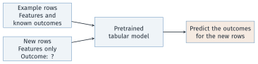{width="100%"}

* Pretrain on many tasks, often using simulated tables.
* Use example rows as **context**; keep pretrained weights fixed.
* For forecasting, turn time and calendar information into features.

## TimeGPT: an encoder–decoder transformer

{width="100%"}

**Attention** combines information across positions. A **feed-forward network** refines the information at each position.

::: aside
Simplified TimeGPT-1 architecture (Garza et al.). Repeated layers and normalisation are omitted.
:::

## TimeGPT: the model runs on Nixtla's service

{width="100%"}

* For tourism, send the history and ask for four quarters.
* Set fine-tuning arguments to adapt the model to that history.
* The call needs an API key and available account quota.

## Chronos-2: an encoder-only transformer

{width="100%"}

**Time attention**: share information across the history.\
**Group attention**: share information across related series or predictors, when supplied.

## 10-minute break

::: {.callout-important}
## After the break
Forecast quarterly tourism, examine outputs, and compare zero-shot forecasts with fine-tuned forecasts.
:::

# Example: forecasting Australian tourism

## Our forecasting task

* **Series:** Snowy Mountains, Holiday travel.
* **Target:** quarterly overnight trips, in thousands.
* **History:** 1998 Q1 to 2017 Q4, 80 observations.
* **Task:** forecast the four quarters of 2017 using data available through 2016.

::: {.callout-note}
## The steps we will follow
Prepare the history → forecast → evaluate → adapt → compare.
:::

## From a tsibble to model input

Select the same series in R. We will pass it to the models through their Python interfaces:

```r
tourism |>
  filter(Region == "Snowy Mountains", Purpose == "Holiday")
```

The Python interface uses three columns:

| Workshop column | Model column | Meaning |
|---|---|---|
| Region and Purpose | `unique_id` | Series identifier |
| Quarter | `ds` | Quarter-start date |
| Trips | `y` | Trips, thousands |

## Prepare the tourism series in Python

The model needs an identifier, a date and the number of trips.

```python
import pandas as pd
import numpy as np
tourism = pd.read_csv("data/tourism.csv", parse_dates=["Quarter"])
keep = ((tourism.Region == "Snowy Mountains") &
        (tourism.Purpose == "Holiday"))
df = tourism.loc[keep].rename(columns={"Quarter": "ds", "Trips": "y"})
df["unique_id"] = "Snowy Mountains / Holiday"
df = df[["unique_id", "ds", "y"]].sort_values("ds")
H = 4
history, test = df.iloc[:-H], df.iloc[-H:]
```

Result: 76 historical observations and 4 test observations.

## History, validation and the final test

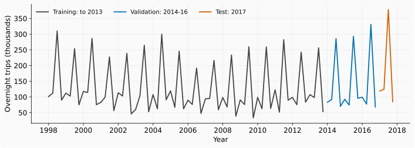{width="100%"}

Validation uses three four-quarter forecasts covering 2014–2016. The 2017 observations are reserved for the final comparison.

## Start with a seasonal-naive forecast

For each quarter of 2017, repeat the corresponding observation from 2016.

```python
baseline = test[["unique_id", "ds"]].copy()
baseline["prediction"] = history["y"].tail(H).to_numpy()
baseline["prediction"].round(2).tolist()
```

```text
[99.21, 77.21, 330.99, 67.95]
```

These are forecasts for Q1–Q4, in thousands of trips. Every model will be compared with this benchmark on the same dates.

## Zero-shot forecasting with TimeGPT

```python
from nixtla import NixtlaClient

client = NixtlaClient()  # reads NIXTLA_API_KEY
timegpt = client.forecast(
    df=history, h=H, freq="QS", level=[80],
    finetune_steps=0,  # no update to model weights
)
```

`h=4`: four quarters; `QS`: quarter-start dates; `level=[80]`: an 80% interval.

## Zero-shot forecasting with Chronos-2

Load the model and request a median forecast with an 80% interval.

```python
from chronos import Chronos2Pipeline

pipeline = Chronos2Pipeline.from_pretrained(
    "amazon/chronos-2", device_map="cpu"
)
chronos = pipeline.predict_df(
    history, prediction_length=H,
    quantile_levels=[0.1, 0.5, 0.9],
    id_column="unique_id", timestamp_column="ds",
    target="y",
)
```

## What does the Chronos-2 output contain?

```python
chronos[["ds", "0.1", "0.5", "0.9"]].round(2)
```



`0.5` is the median forecast. `0.1` and `0.9` are the lower and upper interval limits. Values are thousands of trips.

## Chronos-2: forecasts and intervals

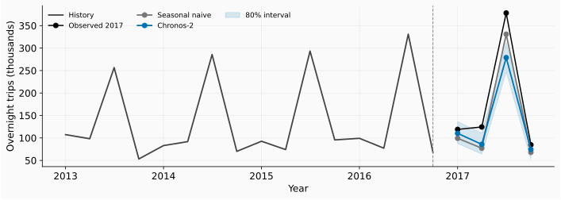{width="100%"}

The model misses the winter peak. Its 80% interval contains 2 of the 4 observed quarters; four quarters are too few to assess long-run coverage.

## MAE or RMSE?

Let $e$ be the observed number of trips minus the forecast.

| Measure | Calculation | How to read it |
|---|---|---|
| MAE | $\operatorname{mean}(\lvert e\rvert)$ | Average absolute miss |
| RMSE | $\sqrt{\operatorname{mean}(e^2)}$ | Gives large misses more weight |

* Both are in thousands of trips; smaller is better.
* Keep MAE as the main measure for our median forecasts.
* Also report RMSE to show the effect of large errors.

## Calculate both errors on the same forecasts

Match each forecast with the observation for that quarter.

```python
checked = test.merge(chronos, on=["unique_id", "ds"],
                     validate="one_to_one")
errors = checked["y"] - checked["0.5"]
mae = errors.abs().mean()
rmse = np.sqrt((errors ** 2).mean())
print(f"MAE: {mae:.2f}; RMSE: {rmse:.2f}")
```

```text
MAE: 39.27; RMSE: 53.75
```

Before changing the model, check its performance on earlier forecast periods as well.

## Check earlier forecasts before choosing settings

Forecast one year at a time, using only the history available then.

::: columns
::: {.column width="40%"}
| History ends | Forecast year |
|---|---|
| 2013 Q4 | 2014 |
| 2014 Q4 | 2015 |
| 2015 Q4 | 2016 |
:::
::: {.column width="60%"}

:::
:::

These scores cover 12 validation quarters. Keep 2017 for the final test.

## Fine-tuning TimeGPT

Use the same history and horizon, with ten training updates.

```python
timegpt_ft = client.forecast(
    df=history, h=H, freq="QS", level=[80],
    finetune_steps=10,
    finetune_depth=1,
    finetune_loss="mae",
)
```

* `finetune_steps` counts training updates; `h` counts future quarters.
* `finetune_loss="mae"` uses absolute errors during adaptation.
* Compare on the same four quarters using both metrics.

## Fine-tuning Chronos-2 with LoRA

LoRA trains a small set of added weights while keeping the original weights fixed.

```python
adapted = pipeline.fit(
    inputs=[history.y.to_numpy(dtype=np.float32)],
    prediction_length=H,
    finetune_mode="lora", num_steps=10,
    **lora_settings,
)
```

`lora_settings` contains the fixed training settings listed in the notebook.

::: {.callout-note}
## What changes?
We get an adapted model. The history and the four forecast dates stay the same.
:::

## Forecast again with the adapted model

```python
chronos_ft = adapted.predict_df(
    history, prediction_length=H, quantile_levels=[0.1, 0.5, 0.9],
    id_column="unique_id", timestamp_column="ds", target="y",
)
```

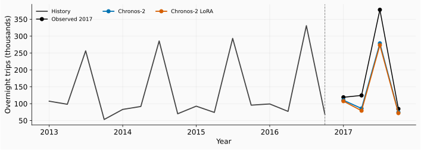{width="85%" fig-align="center"}

The adapted model still misses the winter peak. Did its overall error improve?

## Results on the held-out tourism year



Seasonal naive has the smallest error under both measures. Ten-step LoRA made both scores worse; this one year cannot establish a general ranking.

## What other information is known when we forecast?

Suppose we are forecasting in December 2016.

| Information for 2017 | Available now? |
|---|---|
| Calendar quarter | Yes |
| Actual weather | No |
| Actual number of trips | No: our forecast target |

Supply historical predictor values and any future values known at forecast time.

The lab uses calendar features through `future_df`. Check their value on earlier forecasts.

# Evidence from public health forecasting

## Beyond tourism: forecasts for health supplies

* 20,736 monthly product-location series from Lao.
* Five clinical domains; forecast horizons of 1, 3 and 6 months.
* Compare pretrained and fine-tuned models with statistical and global forecasting benchmarks.

::: {.callout-note}
## Why use RMSSE here?
RMSSE is RMSE divided by a scale based on historical seasonal changes. It lets us compare errors across series with different volumes. Smaller is better.
:::

## Lao health supplies: accuracy and runtime

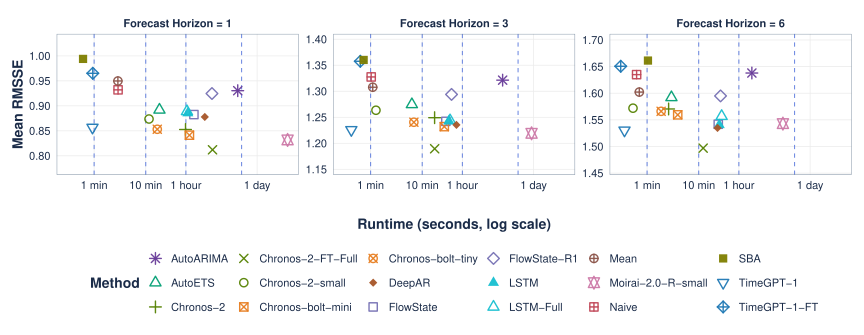{width="80%" fig-align="center"}

Lower and further left is preferable. Chronos-2 fine-tuning improves accuracy here, but adds computation.

::: aside
Source: Hewage, Rostami-Tabar, Syntetos and Liberatore, *Foundation models in low-resource settings*.
:::

# Further reading and lab notebook

## Continue with the tourism lab

* Read and reproduce saved outputs first.
* Run models when credentials or weights are available.
* Try another region and purpose, using earlier validation periods.
* Record the version, data split, metrics and one limitation.

::: {.callout-important}
## Independent lab
`exercises/day5-foundation_models/tourism_lab.ipynb`
:::

## Further reading

::: {style="font-size:0.8em"}
* [FPP Python, Chapter 15](https://otexts.com/fpppy/15-foundation-models.html): foundation models and transfer learning.
* Peixeiro, *Time Series Forecasting Using Foundation Models*, Chapters 1 and 2: concepts and the pretraining-to-adaptation flow.
* [Nixtla](https://www.nixtla.io/docs) and [Chronos](https://github.com/amazon-science/chronos-forecasting): executable APIs.
* Bergmeir, *Forecasting for Data Scientists*, Theory Session 2: global models and evaluation.
* Molnar (2026), *Tabular Foundation Models*, Chapters 3–4 and 9: in-context prediction and forecasting.
* [Tourism documentation](https://tsibble.tidyverts.org/reference/tourism.html). We use the workshop's CSV snapshot.
* Harsha Chamara Hewage, Bahman Rostami-Tabar, Aris Syntetos and Federico Liberatore. *Foundation models in low-resource settings: Evaluating AI-driven forecasting in global health supply chains*.
:::

## Optional: turn tourism forecasting into a table

One row per quarter; predict trips from the feature columns.

| Quarter | Time index | Quarter of year | Trips (thousands) |
|---|---|---|---|
| 2016 Q1 | 73 | 1 | 99.21 |
| 2016 Q2 | 74 | 2 | 77.21 |
| 2016 Q3 | 75 | 3 | 330.99 |
| 2016 Q4 | 76 | 4 | 67.95 |
| 2017 Q1 | 77 | 1 | ? |
| 2017 Q2 | 78 | 2 | ? |
| 2017 Q3 | 79 | 3 | ? |
| 2017 Q4 | 80 | 4 | ? |

Use historical rows as context. Supply future features; keep future trips unknown.

## Optional: patches and embeddings

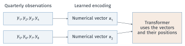{width="100%"}

* A **patch** is a group of consecutive observations.
* An **embedding** turns that patch into a list of numbers the model can process.
* Position information preserves the order of the patches.

::: aside
Four-quarter patches are illustrative. Model patch sizes vary.
:::

## Optional: attention weights

Attention combines information from past patches.

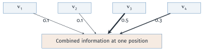{width="100%"}

* Here the combination is $0.1\mathbf{v}_1+0.1\mathbf{v}_2+0.5\mathbf{v}_3+0.3\mathbf{v}_4$.
* Each attention head forms its own combination.

::: aside
These illustrative weights depend on the input. They are not stored model parameters.
:::

## Optional: historical training windows

Use a past window to predict the observations immediately after it.

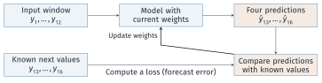{width="100%"}

Repeat across windows and series. The training targets are already in the historical data.
